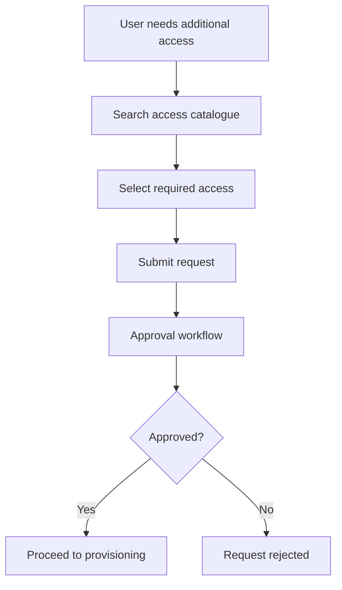

# 01. Introduction to Identity Security Cloud

## 1. Understanding Identity Governance

As organisations grow, the number of people accessing their systems, applications, and data also increases. These people may include employees, contractors, vendors, partners, and other external users.

Each person requires access based on their responsibilities. However, those responsibilities can change over time. Employees join, change roles, move between departments, or leave the organisation.

Managing these changes manually can create security and operational problems:

- Users may retain access after changing roles.
- Employees may accumulate unnecessary permissions.
- Access may be granted without appropriate approval.
- Conflicting permissions may create opportunities for fraud.
- Removing access after an employee leaves may be delayed.
- Organisations may struggle to demonstrate who has access to what.

This is where **Identity Governance and Administration (IGA)** becomes important.

### What is Identity Governance?

Identity Governance is the process of managing, controlling, reviewing, and monitoring user access to organisational resources throughout the identity lifecycle.

It helps an organisation ensure that:

- Users receive access appropriate to their responsibilities.
- Access is approved according to organisational policies.
- Existing access is reviewed periodically.
- Unnecessary or inappropriate access is removed.
- Access-related activities can be monitored and demonstrated for compliance purposes.

In simple terms, identity governance helps an organisation answer four important questions:

1. Who has access?
2. What can they access?
3. Should they have that access?
4. Is that access still appropriate?

### The four objectives of identity governance

Effective identity governance balances four organisational objectives:

| Objective | What it means |
|---|---|
| Strengthen security and reduce risk | Prevent excessive, unnecessary, or inappropriate access. |
| Improve compliance and audit performance | Maintain visibility and evidence of access decisions and reviews. |
| Deliver efficient access | Ensure people can obtain the access required to perform their work. |
| Reduce operational costs | Automate repetitive access management and administrative activities. |

These objectives must work together. Granting access quickly is useful, but doing so without appropriate controls can introduce security risks.

---

## 2. What is SailPoint Identity Security Cloud?

**Identity Security Cloud (ISC)** is SailPoint's cloud-based identity security platform. It provides capabilities that help organisations manage identities and govern access across their IT environments.

Rather than treating every access-related activity as an isolated administrative task, ISC brings identity information and governance processes together.

Its capabilities support activities such as:

- Managing identity information.
- Requesting and approving access.
- Reviewing existing access.
- Automating provisioning and de-provisioning.
- Identifying conflicting access through Separation of Duties policies.
- Managing passwords through an additional module.

The platform also incorporates AI-driven recommendations to support access-related decisions.

### Why is a platform like ISC needed?

Consider an organisation with 500 employees and 40 applications.

Without a centralised governance approach, administrators may need to check different applications individually to understand:

- Which employees have accounts in each application.
- What permissions those accounts have.
- Whether the permissions are appropriate.
- Who approved the access.
- Whether access should be removed.

As the organisation grows, this becomes increasingly difficult to manage.

ISC helps bring identity and access information together so that governance activities can be performed with greater visibility and consistency.

---

## 3. Identity Data and Centralised Governance

Identity governance depends on having reliable information about users and the access they hold.

Organisations often maintain identity-related information across multiple systems. These may include HR platforms, databases, directories, on-premises applications, and cloud-based applications.

Identity Security Cloud can collect information from connected sources and present it through a unified interface.

### What does normalisation mean?

Different systems may represent similar information in different ways.

For example:

| Application | User identifier | Department field |
|---|---|---|
| Application A | `alex01` | `dept` |
| Application B | `EMP1024` | `department_name` |
| Application C | `alex.finance` | `business_unit` |

Although the field names and identifiers differ, the information may refer to the same person and organisational attribute.

**Data normalisation** involves representing information in a consistent structure so that it can be interpreted and used more effectively.

In identity governance, this helps create a more unified view of identities and their associated access.

### Why does this matter?

Suppose an employee moves from Finance to Human Resources.

The organisation needs to understand:

- Which identity represents the employee.
- Which applications the employee can access.
- Which existing permissions are no longer required.
- Which new permissions are necessary for the new role.

A consolidated view of identity and access information helps governance processes make these decisions.

**Important:** Centralised visibility does not mean every application or system is replaced by ISC. The platform works with connected sources to support identity governance across the environment.

---

## 4. Core Identity Governance Capabilities in ISC

The introductory course presents four core governance capabilities:

1. Access Requests and Approvals
2. Access Certifications
3. Automated Provisioning
4. Separation of Duties

Password Management is introduced separately as an optional add-on module.

These capabilities address different problems, but they work together as part of identity governance.

### 4.1 Access Requests and Approvals

**Access Requests** allow users to request the permissions or resources they need to perform their job responsibilities.

An organisation can make available access options through a catalogue. Each access option can have an associated approval process.

#### Example

A Finance Analyst needs access to a financial reporting application.

Instead of receiving access informally, the employee submits a request through the organisation's access request process.

The request is reviewed by the designated approver according to the configured approval rules.

#### Typical request flow



**What this capability addresses:** How does a user obtain additional access through an authorised process?

### 4.2 Access Certifications

Access Certifications are used to review access that users already have.

Over time, employees may accumulate permissions that are no longer necessary. This can happen because of role changes, project assignments, temporary responsibilities, or organisational changes.

Access certifications help organisations periodically examine these permissions and decide whether they should be retained or revoked.

An authorised reviewer, such as a manager assigned to the review, can make access decisions.

#### Example

Alex works in Finance but still has access to an HR application from a previous assignment.

During an access review, Alex's manager identifies that the access is no longer required and revokes it.

#### Typical certification decisions

| Decision | Meaning |
|---|---|
| Approve | The access is still required and can be retained. |
| Revoke | The access is no longer appropriate and should be removed. |

The course also introduces **closed-loop remediation**. This means that an access review decision can be followed through to remediation, rather than simply recording the decision and leaving the actual access unchanged.

**What this capability addresses:** Should the user continue to have the access they already possess?

### 4.3 Automated Provisioning

Provisioning is the process of creating, assigning, modifying, or removing accounts and access in connected systems.

It is the implementation side of identity and access management.

Once an access decision has been made, provisioning helps ensure that the corresponding change is carried out in the relevant application or system.

#### Provisioning across the employee lifecycle

| Employee event | Possible provisioning activity |
|---|---|
| Joining | Create accounts and assign required access. |
| Role change | Modify access to reflect new responsibilities. |
| Department change | Remove unnecessary permissions and assign new ones. |
| Leaving | Disable or remove accounts and revoke access according to organisational procedures. |

Removing access is commonly called **de-provisioning**.

#### Access request versus provisioning

These terms are related, but they describe different activities.

| Access Request | Provisioning |
|---|---|
| Initiates a request for access. | Implements an access change. |
| Involves approval decisions. | Involves changes to accounts or permissions. |
| Determines whether access should be granted. | Carries out the approved change. |

For example, an employee may receive approval for access to a financial application. That approval does not itself guarantee that the employee's account has already been updated. Provisioning handles the implementation.

**What this capability addresses:** How are approved access changes carried out in connected systems?

### 4.4 Separation of Duties (SoD)

**Separation of Duties (SoD)** is an internal control principle that prevents one individual from having conflicting responsibilities or combinations of access that could enable fraud, misuse, or unauthorised activity.

The idea is to divide sensitive tasks among different individuals so that a single person does not have excessive control over an entire process.

#### Example: Financial transactions

Consider a process involving payments.

| Responsibility | Assigned user |
|---|---|
| Create a payment | Employee A |
| Approve the payment | Employee B |

If one person can both create and approve a payment, there may be an opportunity to misuse the process.

Separating these responsibilities introduces an additional control.

#### How SoD supports identity governance

Organisations define policies that identify conflicting responsibilities or access combinations.

These policies help identify situations where a user's permissions may violate the organisation's internal controls.

SoD can help organisations:

- Identify conflicts of interest.
- Reduce opportunities for fraud.
- Protect sensitive business processes.
- Support regulatory and internal compliance requirements.

**What this capability addresses:** Does a user's combination of access create a conflict of responsibilities?

---

## 5. Password Management

Password Management is an optional add-on module introduced in the course.

It provides users with an interface to manage and reset their passwords while supporting password policies across applications.

Its capabilities include:

- Self-service password resets.
- Password policy enforcement.
- Multiple authentication options for password-related activities.
- Password management from different devices and networks.

### Why is self-service password reset useful?

Without self-service functionality, an employee who forgets a password may need to contact the IT helpdesk.

If this happens frequently across an organisation, it increases administrative workload and delays productivity.

Self-service password reset allows users to complete supported password reset activities themselves, subject to the organisation's security requirements.

**What this capability addresses:** How can users manage and reset their passwords securely without relying on manual helpdesk intervention for every request?

---

## 6. How the Capabilities Work Together

The four core governance capabilities are not interchangeable. Each addresses a different part of the access lifecycle.

Consider an employee joining an organisation.

1. The organisation identifies the employee's identity and access requirements.
2. The employee or an authorised administrator initiates the required access process.
3. Access requests follow the configured approval workflow where applicable.
4. Provisioning implements the approved access changes.
5. Separation of Duties policies help identify conflicting access combinations.
6. Access certifications periodically review whether the employee's existing access remains appropriate.

Password Management can support the employee's password-related needs alongside these activities.

### Conceptual overview
```mermaid
flowchart TD
    A["Identity and access information"] --> B["Access Governance"]

    B --> C["Access Requests and Approvals"]
    B --> D["Separation of Duties"]

    C --> E["Provisioning"]
    D --> E

    E --> F["User receives access"]
    F --> G["Access Certifications"]

    G --> H["Review decision"]
    H --> I["Retain access"]
    H --> J["Revoke access"]
    J --> K["De-provisioning"]

    L["Password Management"]
 ```
This is a conceptual relationship between the capabilities, not a mandatory sequence that every organisation must follow.

---

## 7. Quick Reference: Understanding the Differences

| Capability | Primary purpose | Question it answers |
|---|---|---|
| Access Requests | Requesting additional access | What access does the user need? |
| Approvals | Authorising requested access | Should the request be approved? |
| Provisioning | Implementing access changes | Has the required access change been carried out? |
| De-provisioning | Removing accounts or access | How is access removed when it is no longer required? |
| Access Certifications | Reviewing existing access | Should the user still have this access? |
| Separation of Duties | Preventing conflicting access | Does the user's access create a control conflict? |
| Password Management | Managing passwords | How can users securely manage or reset passwords? |

## 8. Key Terms

| Term | Meaning |
|---|---|
| Identity Governance | Managing and reviewing identities and their access to organisational resources. |
| Identity | A digital representation of a person or other entity that requires access to organisational resources. |
| Access Request | A request submitted to obtain access to a resource. |
| Approval | An authorisation decision made according to an organisation's configured process. |
| Provisioning | Creating or assigning accounts and access in connected systems. |
| De-provisioning | Removing accounts or access when they are no longer required. |
| Access Certification | A formal review of existing user access. |
| Separation of Duties | A control principle that prevents conflicting responsibilities or access combinations. |
| Access Catalogue | A collection of access options that users can search and request. |
| Closed-loop Remediation | Following an access review decision through to the required corrective action. |
| Normalisation | Representing data in a consistent structure so it can be interpreted and used more effectively. |

## 9. Further Learning

This lesson establishes the purpose of Identity Security Cloud and introduces the main governance capabilities.

The next step is to understand how the platform is structured and how its components communicate and interact.

**Next chapter:** [02. Identity Security Cloud Architecture](../02-Identity-Security-Cloud-Architecture/README.md)

---

*These notes are independently prepared learning material. They combine concepts introduced in the SailPoint University course with explanatory examples to support understanding. For product-specific implementation details, refer to SailPoint's official documentation.*
