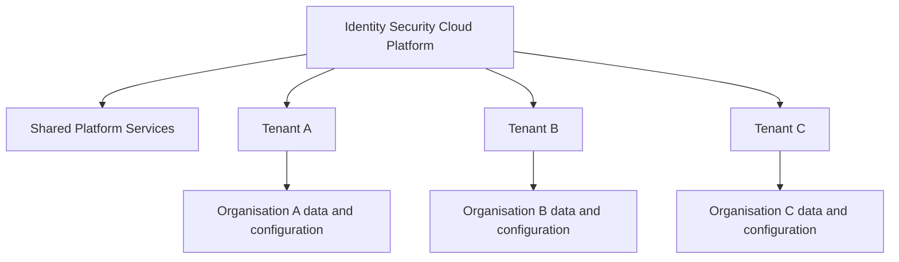
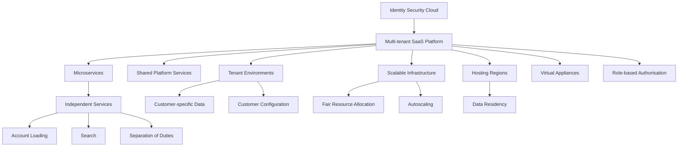

# 02. Identity Security Cloud Architecture

## 1. Understanding the Architecture

Identity Security Cloud (ISC) uses a **cloud-native, microservices-based, multi-tenant SaaS architecture**.

To understand this architecture, three concepts are important:

- **SaaS (Software as a Service):** The software is hosted and operated by the service provider and made available to customers over the internet.
- **Microservices:** The application is divided into smaller, independently deployable services, each responsible for a specific function.
- **Multi-tenancy:** Multiple customers use the same underlying platform infrastructure while maintaining separate tenant environments and data.

These architectural choices allow ISC to provide identity governance services without requiring every customer to build and maintain the entire platform infrastructure themselves.

## 2. Microservices Architecture

### What are microservices?

Microservices are an architectural approach in which an application is developed as a collection of small, independent services.

Each service is responsible for a specific function and communicates with other services when necessary.

Instead of building one large application that performs every operation, functionality is divided into smaller components.

For example, an identity governance platform may have separate services responsible for:

- Loading accounts from connected applications.
- Searching identity information.
- Managing Separation of Duties policies.
- Processing access-related activities.

Each service focuses on its own responsibility.

### Microservices vs. Monolithic Architecture

| Monolithic architecture | Microservices architecture |
|---|---|
| Application is built as one large unit. | Application is divided into smaller services. |
| Components are closely connected within the application. | Services are independently deployable. |
| Changes may require redeploying a larger part of the application. | Individual services can be updated independently. |
| Scaling may involve scaling the larger application. | Individual services can be scaled according to demand. |
| A failure in a major component can affect a larger portion of the application. | Failures can potentially be isolated to individual services. |

### How ISC uses microservices

ISC uses multiple instances of services to support its operations.

For example, if account loading requires additional processing capacity, the platform can make additional account-loading service instances available rather than scaling every other service unnecessarily.

This provides flexibility in how platform resources are allocated.

### Availability and fault recovery

The course explains that ISC deploys duplicate microservice instances in production environments.

This supports service availability:

- Multiple instances can perform the same type of work.
- If an instance becomes unavailable, another instance may continue handling requests.
- Services can be configured to restart automatically after failure.
- Monitoring teams can receive alerts when service problems occur.

**Important distinction:** Microservices do not eliminate downtime. Redundancy, monitoring, recovery mechanisms, and appropriate service design help reduce the impact of failures.

## 3. Multi-Tenant Architecture

### What is a tenant?

A tenant is a customer-specific environment within a shared SaaS platform.

In a multi-tenant architecture, multiple customers use the same underlying platform infrastructure, but their environments and data remain logically separated.

For example:

- Organisation A uses ISC to manage its employees and access.
- Organisation B uses the same ISC platform to manage its own identities and access.
- Both organisations use shared platform infrastructure, but Organisation A must not be able to access Organisation B's tenant data.

### How multi-tenancy works

The platform provides common infrastructure and services while maintaining separation between customer tenants.

### Shared services

The course explains that tenants have access to a set of shared services.

These are platform-level services that support the operation of the SaaS environment rather than being built separately for every customer.

The important distinction is:

| Shared platform services | Tenant-specific environment |
|---|---|
| Support common platform operations. | Contains customer-specific identity and configuration information. |
| Used across the platform. | Used by the respective organisation. |
| Managed as part of the SaaS platform. | Administered according to the customer's assigned permissions. |

**Remember:** Multi-tenancy does not mean customers share their identity data with one another. The platform is shared, while tenant data and access are separated.

## 4. Resource Allocation and Autoscaling

A multi-tenant platform must manage processing resources fairly because different organisations may have different workloads.

One tenant may have thousands of identities and frequent account aggregation activities, while another may have a much smaller environment.

ISC uses mechanisms described in the course to manage this demand.

### 4.1 Fairness Algorithm

A fairness algorithm determines how much processing capacity each tenant can use relative to its size.

Its purpose is to prevent one tenant from consuming a disproportionate share of shared processing resources.

For example:

Imagine two organisations using the same platform:

- Organisation A has 10,000 identities.
- Organisation B has 500 identities.

Their processing requirements may differ significantly. Resource allocation should account for these differences rather than allowing one tenant to monopolise shared capacity.

The goal is fair access to shared processing resources.

### 4.2 Autoscaling

Autoscaling is the automatic adjustment of available computing resources according to workload demand.

When demand increases, additional processing capacity can be made available. When demand decreases, unnecessary resources can be reduced.

| Situation | Autoscaling response |
|---|---|
| Processing demand increases | Additional resources or service instances can be added. |
| Processing demand decreases | Excess resources can be reduced. |
| Workload fluctuates | Available capacity adjusts according to demand. |

### Why is autoscaling useful?

- Helps handle changing workloads.
- Supports platform responsiveness.
- Avoids maintaining unnecessary processing capacity during low-demand periods.
- Helps optimise infrastructure costs.

### Fairness vs. Autoscaling

These concepts solve different problems.

| Fairness algorithm | Autoscaling |
|---|---|
| Determines how shared processing resources are allocated between tenants. | Adjusts the amount of available processing capacity. |
| Focuses on resource distribution. | Focuses on resource availability. |
| Helps prevent disproportionate resource consumption. | Helps respond to changing workloads. |

## 5. Virtual Appliances (VA)

### What is a Virtual Appliance?

A **Virtual Appliance (VA)** is a preconfigured virtual machine that provides a specific set of software functions.

In the ISC architecture introduced by the course, Virtual Appliances are relevant to connecting the cloud platform with customer-managed environments.

They are an important architectural component when identity-related operations involve systems that are not directly hosted within SailPoint's cloud environment.

### Why are Virtual Appliances standardised?

SailPoint requires Virtual Appliances to be identical across its customer base for support, feature, and management purposes.

Standardisation helps maintain consistency in:

- Deployment.
- Configuration.
- Updates.
- Troubleshooting.
- Technical support.

### Virtual Appliance clustering

Clustering involves grouping multiple appliance instances to support availability and workload handling.

The course introduces Virtual Appliance communication flow and clustering as separate topics.

Their detailed communication mechanisms, deployment requirements, and clustering behaviour should be studied alongside the relevant architecture diagrams or technical documentation rather than assumed from the introductory description alone.

**Key distinction:** A Virtual Appliance is not the same thing as a tenant. The tenant is the customer's logical environment in ISC; a VA is a virtual machine used as part of the supporting architecture.

## 6. SaaS Regions and Data Residency

### What is a hosting region?

A hosting region refers to the geographical location where cloud infrastructure and customer data are hosted.

The course introduces SailPoint's availability zones as the physical hosting locations for Identity Security Cloud.

Each zone can host multiple tenants.

During initial deployment, an organisation selects an appropriate hosting location for its tenant.

### What is data residency?

Data residency refers to the geographical location in which an organisation's data is stored and processed.

Organisations may have legal, regulatory, contractual, or internal requirements that restrict where certain data can reside.

For example, an organisation may have a requirement that specific employee information must remain within an approved geographical jurisdiction.

Therefore, selecting an appropriate ISC hosting location is an important deployment consideration.

### Important considerations

- The selected hosting location determines where tenant data resides, according to the platform's applicable data-location arrangements.
- Organisations should evaluate their data residency requirements before deployment.
- The selected location should meet relevant organisational and regulatory requirements.

**Remember:** Hosting location is not simply a performance preference. It can be an important compliance and data governance decision.

## 7. Language and Localisation

ISC supports users with different language preferences.

The course explains that the platform can respond to a user's browser language setting to display the appropriate supported language.

Organisations can also provide translations for standard security questions or configure new questions in different languages during initial deployment.

### Why does localisation matter?

Consider a multinational organisation with employees in India, France, and Japan.

If users can interact with governance processes in a language they understand, the experience becomes more accessible and easier to use.

Localisation can therefore support:

- Better user experience.
- Easier participation in governance activities.
- Clearer communication during security-related interactions.

## 8. Identity Security Cloud Authorisation Levels

### What is authorisation?

Authentication and authorisation are related, but they answer different questions.

| Concept | Question answered |
|---|---|
| Authentication | Who are you? |
| Authorisation | What are you allowed to access or do? |

In ISC, authorisation levels determine which platform functions and administrative activities a user is permitted to access.

Not every user needs administrative privileges. Assigning different levels of authorisation helps organisations distribute responsibilities while following the principle of least privilege.

### Principle of Least Privilege

The principle of least privilege means that users should receive only the permissions necessary to perform their assigned responsibilities.

For example, a user responsible for reviewing access certifications does not necessarily need permission to manage all platform sources or organisational settings.

Separating administrative responsibilities reduces unnecessary privilege and helps maintain governance controls.

### Authorisation levels introduced in the course

| Authorisation level | General responsibility indicated by its name |
|---|---|
| User | Access to standard user-facing functionality. |
| Org Admin | Organisation-level administration. |
| HelpDesk | Support-related activities. |
| Certification Admin | Administration of access certification activities. |
| Report Admin | Reporting-related administration. |
| Role Admin | Role-related administration. |
| Source Admin | Source-related administration. |

These names provide an introductory understanding of the different responsibilities. The exact permissions and supported actions depend on the platform's authorisation configuration and should be verified in SailPoint's role and permission documentation.

### Strong authentication for privileged activities

The course highlights that users receiving additional administrative permissions, such as Org Admin, Source Admin, and Certification Admin, must perform strong authentication to use their new capabilities.

Strong authentication is also required for certain sensitive activities, including:

- Resetting an ISC password.
- Changing personal preferences.

The security purpose is to provide additional assurance before sensitive actions are performed.

**Important:** Having an account in ISC does not automatically make someone an administrator. Administrative access is assigned through appropriate authorisation.

---

## 9. Putting the Architecture Together

The following diagram summarises the major architectural concepts introduced in this lesson.

This is a conceptual map of the architecture, not a complete technical deployment diagram or representation of all internal ISC components.

## 10. Quick Reference

| Concept | Purpose |
|---|---|
| SaaS | Delivers software through a cloud-hosted service. |
| Microservices | Divides an application into smaller, independently deployable services. |
| Multi-tenancy | Allows multiple customers to use shared infrastructure while keeping tenant environments separated. |
| Shared services | Provide common platform-level functionality. |
| Fairness algorithm | Helps distribute shared processing resources between tenants. |
| Autoscaling | Adjusts available processing resources according to demand. |
| Virtual Appliance | A preconfigured virtual machine used as part of the supporting architecture. |
| Clustering | Groups appliance instances to support availability and workload handling. |
| Hosting region | Geographical location of the cloud infrastructure. |
| Data residency | Determines where organisational data resides. |
| Localisation | Adapts the platform experience to supported language preferences. |
| Authorisation | Determines what a user is permitted to do. |
| Least privilege | Limits permissions to what a user needs for their responsibilities. |
| Strong authentication | Provides additional identity verification for sensitive activities. |

## 11. Key Takeaways

- ISC uses a microservices-based, multi-tenant SaaS architecture.
- Microservices divide platform functionality into smaller, independent services.
- Multiple tenants use shared platform infrastructure while maintaining separation of customer data.
- Fairness mechanisms and autoscaling help manage shared processing capacity.
- Virtual Appliances are standardised virtual machines used in the supporting architecture.
- Hosting location is an important consideration for data residency.
- Language localisation supports users across different language preferences.
- Authorisation levels separate administrative responsibilities.
- Strong authentication provides additional protection for sensitive activities.

---

**Next chapter:** [03. Identity Model](../03-Identity-Model/README.md)

*These notes are independently prepared learning material based on the SailPoint University course and supplementary conceptual explanations. Product-specific implementation details should be checked against current SailPoint documentation.*
