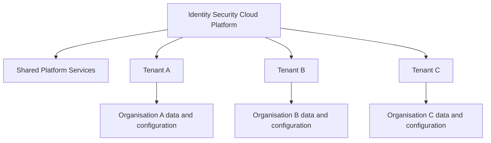
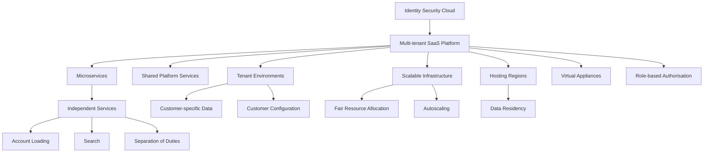

# 02. Identity Security Cloud Architecture

## 1. Understanding the Architecture

Identity Security Cloud (ISC) uses a **cloud-native, microservices-based, multi-tenant SaaS architecture**.

To understand this architecture, three concepts are important:

- **SaaS (Software as a Service):** The software is hosted and operated by the service provider and made available to customers over the internet.
- **Microservices:** The application is divided into smaller, independently deployable services, each responsible for a specific function.
- **Multi-tenancy:** Multiple customers use the same underlying platform infrastructure while maintaining separate tenant environments and data.

These architectural choices allow ISC to provide identity governance services without requiring every customer to build and maintain the entire platform infrastructure themselves.

## 2. Microservices Architecture

### What are microservices?

Microservices are an architectural approach in which an application is developed as a collection of small, independent services.

Each service is responsible for a specific function and communicates with other services when necessary.

Instead of building one large application that performs every operation, functionality is divided into smaller components.

For example, an identity governance platform may have separate services responsible for:

- Loading accounts from connected applications.
- Searching identity information.
- Managing Separation of Duties policies.
- Processing access-related activities.

Each service focuses on its own responsibility.

### Microservices vs. Monolithic Architecture

| Monolithic architecture | Microservices architecture |
|---|---|
| Application is built as one large unit. | Application is divided into smaller services. |
| Components are closely connected within the application. | Services are independently deployable. |
| Changes may require redeploying a larger part of the application. | Individual services can be updated independently. |
| Scaling may involve scaling the larger application. | Individual services can be scaled according to demand. |
| A failure in a major component can affect a larger portion of the application. | Failures can potentially be isolated to individual services. |

### How ISC uses microservices

ISC uses multiple instances of services to support its operations.

For example, if account loading requires additional processing capacity, the platform can make additional account-loading service instances available rather than scaling every other service unnecessarily.

This provides flexibility in how platform resources are allocated.

### Availability and fault recovery

The course explains that ISC deploys duplicate microservice instances in production environments.

This supports service availability:

- Multiple instances can perform the same type of work.
- If an instance becomes unavailable, another instance may continue handling requests.
- Services can be configured to restart automatically after failure.
- Monitoring teams can receive alerts when service problems occur.

**Important distinction:** Microservices do not eliminate downtime. Redundancy, monitoring, recovery mechanisms, and appropriate service design help reduce the impact of failures.

## 3. Multi-Tenant Architecture

### What is a tenant?

A tenant is a customer-specific environment within a shared SaaS platform.

In a multi-tenant architecture, multiple customers use the same underlying platform infrastructure, but their environments and data remain logically separated.

For example:

- Organisation A uses ISC to manage its employees and access.
- Organisation B uses the same ISC platform to manage its own identities and access.
- Both organisations use shared platform infrastructure, but Organisation A must not be able to access Organisation B's tenant data.

### How multi-tenancy works

The platform provides common infrastructure and services while maintaining separation between customer tenants.

### Shared services

The course explains that tenants have access to a set of shared services.

These are platform-level services that support the operation of the SaaS environment rather than being built separately for every customer.

The important distinction is:

| Shared platform services | Tenant-specific environment |
|---|---|
| Support common platform operations. | Contains customer-specific identity and configuration information. |
| Used across the platform. | Used by the respective organisation. |
| Managed as part of the SaaS platform. | Administered according to the customer's assigned permissions. |

**Remember:** Multi-tenancy does not mean customers share their identity data with one another. The platform is shared, while tenant data and access are separated.

## 4. Resource Allocation and Autoscaling

A multi-tenant platform must manage processing resources fairly because different organisations may have different workloads.

One tenant may have thousands of identities and frequent account aggregation activities, while another may have a much smaller environment.

ISC uses mechanisms described in the course to manage this demand.

### 4.1 Fairness Algorithm

A fairness algorithm determines how much processing capacity each tenant can use relative to its size.

Its purpose is to prevent one tenant from consuming a disproportionate share of shared processing resources.

For example:

Imagine two organisations using the same platform:

- Organisation A has 10,000 identities.
- Organisation B has 500 identities.

Their processing requirements may differ significantly. Resource allocation should account for these differences rather than allowing one tenant to monopolise shared capacity.

The goal is fair access to shared processing resources.

### 4.2 Autoscaling

Autoscaling is the automatic adjustment of available computing resources according to workload demand.

When demand increases, additional processing capacity can be made available. When demand decreases, unnecessary resources can be reduced.

| Situation | Autoscaling response |
|---|---|
| Processing demand increases | Additional resources or service instances can be added. |
| Processing demand decreases | Excess resources can be reduced. |
| Workload fluctuates | Available capacity adjusts according to demand. |

### Why is autoscaling useful?

- Helps handle changing workloads.
- Supports platform responsiveness.
- Avoids maintaining unnecessary processing capacity during low-demand periods.
- Helps optimise infrastructure costs.

### Fairness vs. Autoscaling

These concepts solve different problems.

| Fairness algorithm | Autoscaling |
|---|---|
| Determines how shared processing resources are allocated between tenants. | Adjusts the amount of available processing capacity. |
| Focuses on resource distribution. | Focuses on resource availability. |
| Helps prevent disproportionate resource consumption. | Helps respond to changing workloads. |

## 5. Virtual Appliances (VA)

### What is a Virtual Appliance?

A **Virtual Appliance (VA)** is a preconfigured virtual machine that provides a specific set of software functions.

In the ISC architecture introduced by the course, Virtual Appliances are relevant to connecting the cloud platform with customer-managed environments.

They are an important architectural component when identity-related operations involve systems that are not directly hosted within SailPoint's cloud environment.

### Why are Virtual Appliances standardised?

SailPoint requires Virtual Appliances to be identical across its customer base for support, feature, and management purposes.

Standardisation helps maintain consistency in:

- Deployment.
- Configuration.
- Updates.
- Troubleshooting.
- Technical support.

### Virtual Appliance clustering

Clustering involves grouping multiple appliance instances to support availability and workload handling.

The course introduces Virtual Appliance communication flow and clustering as separate topics.

Their detailed communication mechanisms, deployment requirements, and clustering behaviour should be studied alongside the relevant architecture diagrams or technical documentation rather than assumed from the introductory description alone.

**Key distinction:** A Virtual Appliance is not the same thing as a tenant. The tenant is the customer's logical environment in ISC; a VA is a virtual machine used as part of the supporting architecture.

## 6. SaaS Regions and Data Residency

### What is a hosting region?

A hosting region refers to the geographical location where cloud infrastructure and customer data are hosted.

The course introduces SailPoint's availability zones as the physical hosting locations for Identity Security Cloud.

Each zone can host multiple tenants.

During initial deployment, an organisation selects an appropriate hosting location for its tenant.

### What is data residency?

Data residency refers to the geographical location in which an organisation's data is stored and processed.

Organisations may have legal, regulatory, contractual, or internal requirements that restrict where certain data can reside.

For example, an organisation may have a requirement that specific employee information must remain within an approved geographical jurisdiction.

Therefore, selecting an appropriate ISC hosting location is an important deployment consideration.

### Important considerations

- The selected hosting location determines where tenant data resides, according to the platform's applicable data-location arrangements.
- Organisations should evaluate their data residency requirements before deployment.
- The selected location should meet relevant organisational and regulatory requirements.

**Remember:** Hosting location is not simply a performance preference. It can be an important compliance and data governance decision.

## 7. Language and Localisation

ISC supports users with different language preferences.

The course explains that the platform can respond to a user's browser language setting to display the appropriate supported language.

Organisations can also provide translations for standard security questions or configure new questions in different languages during initial deployment.

### Why does localisation matter?

Consider a multinational organisation with employees in India, France, and Japan.

If users can interact with governance processes in a language they understand, the experience becomes more accessible and easier to use.

Localisation can therefore support:

- Better user experience.
- Easier participation in governance activities.
- Clearer communication during security-related interactions.

## 8. Identity Security Cloud Authorisation Levels

### What is authorisation?

Authentication and authorisation are related, but they answer different questions.

| Concept | Question answered |
|---|---|
| Authentication | Who are you? |
| Authorisation | What are you allowed to access or do? |

In ISC, authorisation levels determine which platform functions and administrative activities a user is permitted to access.

Not every user needs administrative privileges. Assigning different levels of authorisation helps organisations distribute responsibilities while following the principle of least privilege.

### Principle of Least Privilege

The principle of least privilege means that users should receive only the permissions necessary to perform their assigned responsibilities.

For example, a user responsible for reviewing access certifications does not necessarily need permission to manage all platform sources or organisational settings.

Separating administrative responsibilities reduces unnecessary privilege and helps maintain governance controls.

### Authorisation levels introduced in the course

| Authorisation level | General responsibility indicated by its name |
|---|---|
| User | Access to standard user-facing functionality. |
| Org Admin | Organisation-level administration. |
| HelpDesk | Support-related activities. |
| Certification Admin | Administration of access certification activities. |
| Report Admin | Reporting-related administration. |
| Role Admin | Role-related administration. |
| Source Admin | Source-related administration. |

These names provide an introductory understanding of the different responsibilities. The exact permissions and supported actions depend on the platform's authorisation configuration and should be verified in SailPoint's role and permission documentation.

### Strong authentication for privileged activities

The course highlights that users receiving additional administrative permissions, such as Org Admin, Source Admin, and Certification Admin, must perform strong authentication to use their new capabilities.

Strong authentication is also required for certain sensitive activities, including:

- Resetting an ISC password.
- Changing personal preferences.

The security purpose is to provide additional assurance before sensitive actions are performed.

**Important:** Having an account in ISC does not automatically make someone an administrator. Administrative access is assigned through appropriate authorisation.

---
## 8. Identity Security Cloud Authorisation Levels

Identity Security Cloud uses authorisation levels to control what users can view and which actions they can perform within the platform.

Not every person responsible for administering identity governance needs access to every administrative function. For example, someone managing access certification campaigns does not necessarily need permission to configure application sources.

ISC supports different authorisation levels so organisations can distribute administrative responsibilities without granting every administrator unrestricted access.

This approach supports the **Principle of Least Privilege**: users should receive only the permissions necessary to perform their assigned responsibilities.

### 8.1 Understanding the Authorisation Structure

The two extremes of the authorisation scale are:

- **User:** The lowest and most common level, with no elevated administrative privileges.
- **Org Admin:** The highest level of customer-facing administrative access, with broad permissions across the tenant.

Between these two levels are specialised administrative authorisations that allow users to manage particular areas of the platform.

An Org Admin can grant specialised administrative permissions according to an individual's responsibilities.

### 8.2 User

The **User** authorisation level is the default level enforced by ISC when a user's authorisation level is undefined.

It is the lowest and most common level of access.

Users do not have elevated administrative permissions. Their activities are generally limited to their own access and assigned responsibilities.

They can perform activities such as:

- Updating their password.
- Updating their security questions.
- Updating their phone number.
- Responding to tasks assigned by another user.
- Completing tasks assigned through automated ISC processes.

**Example:** An employee receives an access certification task and is asked to review or respond to it. The employee can complete the assigned task without having administrative privileges over the certification system.

**Key point:** A standard User can participate in governance activities without being able to administer the platform.

### 8.3 Org Admin (Organisational Administrator)

In ISC, an organisation's tenant is also referred to as its **Org**.

The Org Admin authorisation level is intended for the organisation's system super users who require broad administrative control over the tenant.

An Org Admin can:

- Visit all customer-accessible screens.
- Run all customer-accessible commands.
- View all data across the tenant.
- Update all data across the tenant.
- Grant specialised administrative permissions to other users.

The Org Admin has the broadest customer-facing permissions available in ISC.

The User and Org Admin levels represent the two extremes of the authorisation scale.

**Example:** An organisation's primary ISC administrator may be responsible for overall platform administration, assigning specialised administrator permissions, and overseeing the tenant's configuration.

**Key point:** Org Admin access is highly privileged. It should be assigned carefully and only to individuals who genuinely require broad administrative control.

### 8.4 Specialised Administrative Authorisation Levels

An Org Admin can assign specialised administrative permissions to individuals according to their job responsibilities.

These permissions allow administrators to manage specific functional areas without automatically receiving the full range of Org Admin capabilities.

#### A. Help Desk

The **Help Desk** authorisation level is intended for users who support other employees with application account and access-related issues.

Help Desk users can:

- View details of a user's identity.
- View the user's current permissions.
- View recent login activity.
- View changes to a user's account access configuration.
- Assist with application account issues.

Their identity and activity visibility applies across all identities.

However, Help Desk users cannot make configuration changes to sources, applications, or other ISC features.

**Example:** An employee reports that they cannot access an application. A Help Desk user can inspect the employee's identity details, current permissions, and relevant account activity to help investigate the issue.

**Key distinction:** Help Desk provides support-related visibility and capabilities, not general platform configuration authority.

#### B. Certification Administrator

The **Certification Administrator** authorisation level allows users to:

- Create certification campaigns.
- Monitor certification campaigns.
- Manage certification campaigns.

A certification campaign is an organised access review exercise in which assigned reviewers examine users' access and make decisions about whether it should be retained or revoked.

**Example:** An organisation schedules an access review for its Finance department. A Certification Administrator can create and manage the campaign and monitor its progress.

**Key distinction:** Certification Administrators manage the certification process. This does not automatically mean they have unrestricted Org Admin privileges.

#### C. Report Administrator

The **Report Administrator** authorisation level allows users to:

- Search for reports wherever reporting functionality is available.
- Save reports.

This permission is focused on reporting activities across ISC.

**Example:** An administrator needs to find and save reports to support an internal access governance review.

**Key distinction:** Report Administrator permissions concern report discovery and saving, rather than general tenant or source configuration.

#### D. Role Administrator

The **Role Administrator** authorisation level allows users to:

- Create roles.
- Manage roles.
- Edit roles.
- Search for reports from selected pages.
- Save reports from selected pages.

Roles are used to organise and manage access according to organisational responsibilities.

**Example:** An administrator responsible for role management can create or modify roles used to represent job functions within the organisation.

**Key distinction:** Role Administrator permissions focus on role management. Their reporting capabilities are more limited in scope than those described for a Report Administrator.

#### E. Source Administrator

The **Source Administrator** authorisation level allows users to:

- Create sources.
- Configure sources.
- Manage sources.
- Edit sources.
- Manage access profiles.

A source represents a connected application or system from which identity and account information can be collected or to which access-related operations may be performed.

An access profile is a collection of access that can be made available and managed through ISC.

**Example:** An administrator responsible for connecting and maintaining an organisation's application sources may need Source Administrator permissions to configure those sources and manage their access profiles.

**Key distinction:** Source Administrators manage source-related functionality and access profiles, rather than having unrestricted administrative control over the entire tenant.

### 8.5 Comparison of Authorisation Levels

| Authorisation level | Main responsibility | Important permissions |
|---|---|---|
| User | Standard platform participation | Manage own permitted information and respond to assigned tasks. |
| Org Admin | Overall tenant administration | View and update all customer-accessible tenant data and perform all customer-accessible administrative actions. |
| Help Desk | User and account support | View identity details, permissions, login activity, and access configuration changes. |
| Certification Administrator | Certification campaign administration | Create, monitor, and manage certification campaigns. |
| Report Administrator | Reporting | Search and save reports wherever available. |
| Role Administrator | Role management | Create, manage, and edit roles; search and save reports from selected pages. |
| Source Administrator | Source and access profile management | Create, configure, manage, and edit sources and access profiles. |

### 8.6 Why Does ISC Separate Administrative Responsibilities?

Consider an organisation with the following team structure:

| Team member | Responsibility | Appropriate authorisation |
|---|---|---|
| Platform administrator | Overall ISC administration | Org Admin |
| IT support specialist | Investigating employee account issues | Help Desk |
| Identity governance specialist | Managing access review campaigns | Certification Administrator |
| Compliance reporting specialist | Finding and saving reports | Report Administrator |
| IAM role specialist | Managing organisational roles | Role Administrator |
| Application integration specialist | Managing application sources and access profiles | Source Administrator |
| Employee | Using the platform and responding to assigned tasks | User |

Without specialised authorisation levels, organisations might have to grant broad administrative permissions to people who only need access to one functional area.

Separating responsibilities helps:

- Reduce unnecessary administrative privileges.
- Limit the impact of accidental or unauthorised changes.
- Assign platform responsibilities according to job functions.
- Support the Principle of Least Privilege.
- Maintain clearer accountability for administrative activities.

### 8.7 Strong Authentication for Privileged Activities

The course also highlights the use of strong authentication for sensitive activities.

Users granted additional administrative permissions, including Org Admin, Source Admin, and Certification Admin, must perform strong authentication to use their new capabilities.

Strong authentication is also required for certain sensitive actions, such as resetting an ISC password or changing personal preferences.

This provides an additional layer of protection before users perform sensitive activities.

**Important distinction:**

- **Authentication** establishes the user's identity.
- **Authorisation** determines what the authenticated user is allowed to do.
- **Strong authentication** provides additional assurance when verifying identity for sensitive activities.

### 8.8 Important Concepts to Remember

1. An undefined authorisation level defaults to User.
2. User is the lowest and most common authorisation level.
3. Org Admin has the broadest customer-facing administrative access.
4. Org Admin can assign specialised administrative permissions.
5. Specialised administrators manage particular functional areas rather than automatically receiving unrestricted tenant access.
6. Help Desk users can view identity and access activity across identities, but cannot configure sources or applications.
7. Certification Administrators manage certification campaigns, while Report Administrators focus on finding and saving reports.
8. Role Administrators manage roles, while Source Administrators manage sources and access profiles.
9. Strong authentication adds protection to sensitive activities.

**Learning takeaway:** ISC authorisation levels provide a way to distribute administrative responsibilities while controlling how much of the platform each person can access and manage.

## 9. Putting the Architecture Together

The following diagram summarises the major architectural concepts introduced in this lesson.

This is a conceptual map of the architecture, not a complete technical deployment diagram or representation of all internal ISC components.

## 10. Quick Reference

| Concept | Purpose |
|---|---|
| SaaS | Delivers software through a cloud-hosted service. |
| Microservices | Divides an application into smaller, independently deployable services. |
| Multi-tenancy | Allows multiple customers to use shared infrastructure while keeping tenant environments separated. |
| Shared services | Provide common platform-level functionality. |
| Fairness algorithm | Helps distribute shared processing resources between tenants. |
| Autoscaling | Adjusts available processing resources according to demand. |
| Virtual Appliance | A preconfigured virtual machine used as part of the supporting architecture. |
| Clustering | Groups appliance instances to support availability and workload handling. |
| Hosting region | Geographical location of the cloud infrastructure. |
| Data residency | Determines where organisational data resides. |
| Localisation | Adapts the platform experience to supported language preferences. |
| Authorisation | Determines what a user is permitted to do. |
| Least privilege | Limits permissions to what a user needs for their responsibilities. |
| Strong authentication | Provides additional identity verification for sensitive activities. |

## 11. Key Takeaways

- ISC uses a microservices-based, multi-tenant SaaS architecture.
- Microservices divide platform functionality into smaller, independent services.
- Multiple tenants use shared platform infrastructure while maintaining separation of customer data.
- Fairness mechanisms and autoscaling help manage shared processing capacity.
- Virtual Appliances are standardised virtual machines used in the supporting architecture.
- Hosting location is an important consideration for data residency.
- Language localisation supports users across different language preferences.
- Authorisation levels separate administrative responsibilities.
- Strong authentication provides additional protection for sensitive activities.

---

**Next chapter:** [03. Identity Model](../03-Identity-Model/README.md)

*These notes are independently prepared learning material based on the SailPoint University course and supplementary conceptual explanations. Product-specific implementation details should be checked against current SailPoint documentation.*
