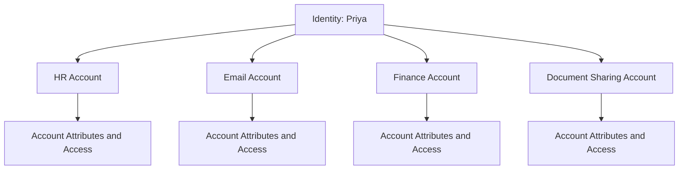
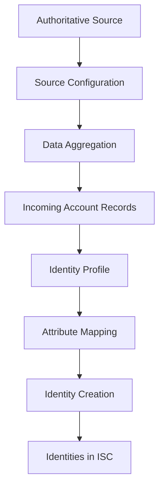
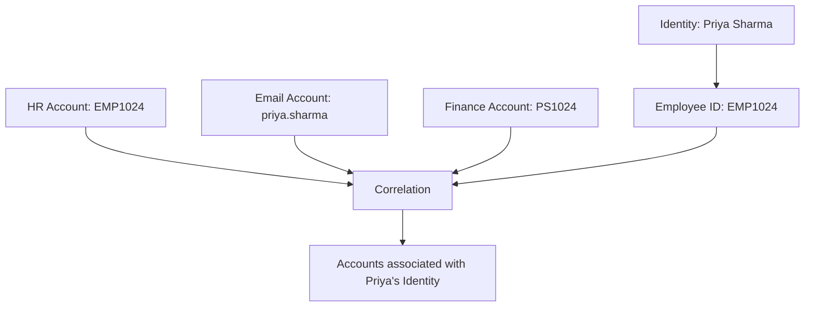
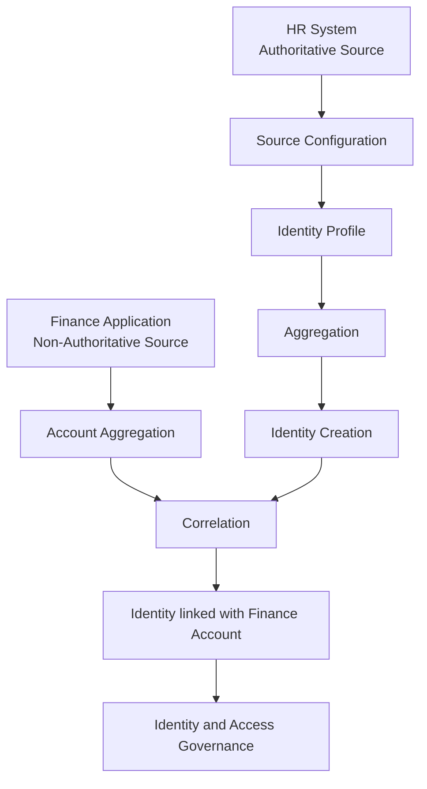

# 03. The Identity Model

## 1. Understanding the Identity Model

The foundation of Identity Security Cloud is the **Identity Model**.

Before an organisation can govern user access, it needs to understand:

- Who the users are.
- Which accounts belong to them.
- What access those accounts provide.

ISC builds this understanding by collecting identity and account information from connected data sources.

An Identity Model consists of three fundamental elements:

1. **Identity:** Represents a person and their organisational information.
2. **Account:** Represents that person's presence in a particular source system.
3. **Access:** Represents what that account or person is permitted to do.

### Understanding the relationship

Consider an employee named Priya who works in the Finance department.

Priya is one person, but she may have accounts in several applications:

- An account in the HR system.
- An account in the email system.
- An account in the Finance application.
- An account in a document-sharing platform.

Each account represents Priya within a particular system. Each account may also have different permissions.

ISC brings these pieces of information together to build a governed view of Priya's identity and access.

The central idea is that one identity can be associated with multiple accounts across different systems.

## 2. The Three Components of the Identity Model

### 2.1 Identity

An **Identity** represents a person and the governance information associated with them.

It contains information that helps ISC understand who the person is and their current position within the organisation.

This can include:

- Personal and organisational attributes.
- Department and job title.
- Manager information.
- Employment status.
- Other security-relevant attributes.

#### Example

| Identity attribute | Example value |
|---|---|
| Employee ID | EMP1024 |
| Name | Priya Sharma |
| Department | Finance |
| Job Title | Finance Analyst |
| Manager | Rahul |
| Employment Status | Active |

These attributes provide context for identity governance decisions.

For example, when Priya moves from Finance to HR, her department and job title may change. These changes can affect the access she requires.

**Remember:** An Identity represents the person, not an individual application login.

### 2.2 Account

An **Account** is a representation of an identity within a particular source system.

Different applications maintain their own records of users. These records are called accounts in the context of the Identity Model.

For example, Priya may have:

| Source system | Account identifier |
|---|---|
| HR System | EMP1024 |
| Email System | priya.sharma |
| Finance Application | PS1024 |
| Document Platform | priya.finance |

These accounts represent the same person in different systems.

An account may contain information about the identity as well as the access privileges assigned within that application.

**Remember:** One person can have multiple accounts across multiple systems.

### 2.3 Access

**Access** defines what a user can and cannot do within an organisation's systems.

It represents the permissions and privileges associated with users and their accounts.

Access can take several forms:

| Access type | General meaning |
|---|---|
| Entitlements | Specific permissions or privileges within an application. |
| Authorisations | Permission to perform particular actions. |
| Groups | Collections of users or permissions used to organise access. |
| Rights | Specific capabilities granted within a system. |
| Permissions | Rules defining what a user is allowed to do. |
| Roles | Collections of access associated with organisational responsibilities. |
| Access Profiles | Configurations that group access for assignment and governance in ISC. |

#### Example

Priya has an account in a Finance application.

That account may provide her with permissions to:

- View financial reports.
- Create expense records.
- Access department-specific information.

However, she may not be permitted to approve financial payments.

The account identifies her within the application. The access privileges determine what she can do there.

### Identity vs. Account vs. Access

| Concept | Represents | Example |
|---|---|---|
| Identity | The person | Priya Sharma |
| Account | The person's record in a system | `priya.sharma` in the email system |
| Access | What the account can do | Read and send emails |

This distinction is fundamental to understanding identity governance.

---

## 3. Understanding Data Sources

ISC needs information from external systems to build and maintain its Identity Model.

The course introduces two important types of sources:

1. Authoritative Sources.
2. Non-Authoritative Sources.

### 3.1 Authoritative Source

An **Authoritative Source** is a third-party application, database, or directory management system that provides a dependable list of people whose identities an organisation wants to govern.

It acts as a trusted source of identity information.

Examples may include:

- Human Resources systems.
- Employee databases.
- Directories containing authoritative personnel information.

An organisation may use an HR system to provide information such as:

- Employee ID.
- Employee name.
- Department.
- Job title.
- Manager.
- Employment status.

ISC uses the information from an authoritative source to create and maintain identities.

#### Example

An organisation uses an HR system to maintain its employee records.

When a new employee joins, the HR system receives the employee's information. ISC can read that information and create the corresponding identity.

**Key point:** An authoritative source provides the identity information used to establish identities in ISC.

### 3.2 Non-Authoritative Source

A **Non-Authoritative Source** is a system that contains accounts or access information that the organisation wants to govern, but which is not designated as the authoritative source for creating the relevant identities.

Examples include:

- Finance applications.
- Document-sharing platforms.
- Business applications.
- Other connected enterprise systems.

The course specifically mentions Box and Dropbox as examples of document-sharing systems.

These systems may contain account information and permissions that ISC needs to associate with existing identities.

#### Example

Priya already has an identity created from the organisation's HR system.

ISC then reads account information from the Finance application and identifies that the account belongs to Priya.

The Finance application provides information about Priya's account and its associated access, rather than acting as the authoritative source for creating her identity.

### Authoritative vs. Non-Authoritative Sources

| Authoritative Source | Non-Authoritative Source |
|---|---|
| Provides trusted identity information. | Provides account and access information to govern. |
| Used to create identities in ISC. | Used to associate accounts and access with identities. |
| Often an HR system or employee directory. | Often a business application or document-sharing system. |
| Establishes the identity population. | Helps build a complete view of users' accounts and access. |

**Important:** The distinction is based on how the source is used in the identity model, not simply on whether the source contains accurate information.

---

## 4. Creating Identities in Identity Security Cloud

To create identities, ISC needs an authoritative source and an Identity Profile.

The course identifies two essential configuration elements:

1. Source Configuration.
2. Identity Profile.

These have different responsibilities.

### 4.1 Source Configuration

A **Source Configuration** defines how ISC connects to and reads information from a source system.

It provides the source definition required for ISC to retrieve information from the authoritative source.

In simple terms, it establishes the connection and describes the source from which data will be collected.

### 4.2 Identity Profile

An **Identity Profile** is a configuration that defines identity policies and identity attribute mappings for a particular population of identities.

It tells ISC how to interpret incoming source records and construct identities from them.

It defines details such as:

- Which source provides the identity information.
- Which attributes make up the identity.
- How identity attributes receive their values.
- Which attributes are used to identify users uniquely.
- Relevant identity policies and provisioning behaviour.

An Identity Profile therefore determines how incoming source information is transformed into an identity representation within ISC.

### Source Configuration vs. Identity Profile

| Source Configuration | Identity Profile |
|---|---|
| Defines the source connection and its configuration. | Defines how identities are created from source information. |
| Allows ISC to read data from the source. | Determines identity attributes and their mappings. |
| Focuses on the source system. | Focuses on the identity population. |

A useful way to remember the distinction:

- **Source Configuration:** Where does the information come from, and how does ISC read it?
- **Identity Profile:** How should ISC use that information to create identities?

---

## 5. Understanding Identity Profiles

An Identity Profile describes the details and behaviour applied to identities created from a particular authoritative source.

It defines the attributes required for identity governance and the mappings used to populate those attributes.

### 5.1 Identity Attribute Mapping

Identity attributes need values.

ISC obtains these values from the incoming records provided by the authoritative source.

For example, an HR system may contain:

| HR source attribute | Value |
|---|---|
| `employee_number` | EMP1024 |
| `full_name` | Priya Sharma |
| `department_name` | Finance |
| `job_title` | Finance Analyst |
| `employment_status` | Active |

An Identity Profile maps these source attributes to the corresponding identity attributes.

| Identity attribute | Mapped source attribute |
|---|---|
| Employee ID | `employee_number` |
| Name | `full_name` |
| Department | `department_name` |
| Job Title | `job_title` |
| Status | `employment_status` |

This mapping allows ISC to construct a consistent identity record from the source data.

### 5.2 One Identity Profile per Authoritative Source

The course specifies that every Authoritative Source must have one Identity Profile.

The Identity Profile is used to define how identities are created from records received from that source.

An organisation may have multiple authoritative sources representing different populations of people.

### 5.3 Identity Profiles and Identity Types

Identity Profiles are commonly aligned with different identity types.

For example, an academic institution may manage four populations:

| Identity Profile | Identity population |
|---|---|
| Faculty | Teaching faculty |
| Students | Enrolled students |
| Contractors | External contractors |
| Staff | Administrative and other employees |

Each profile defines the relevant identity attributes and behaviour for its population.

**Important rule:** Each Identity can be associated with only one Identity Profile.

This means an identity is not simultaneously assigned to multiple profiles, even if the organisation has several authoritative sources and identity populations.

---

## 6. Data Aggregation

**Aggregation** is the process of reading account records from connected sources into Identity Security Cloud.

For an authoritative source, aggregation provides the incoming records used to create identities.

During this process:

1. ISC reads records from the authoritative source.
2. The Identity Profile determines how the incoming attributes should be interpreted.
3. Source attributes are mapped to identity attributes.
4. ISC creates identities based on the configured Identity Profile.
5. The resulting identities are stored in the database associated with the tenant.

### Example

Suppose an organisation has 100 employee records in its HR system.

During aggregation, ISC reads these records.

If the source and Identity Profile are correctly configured, ISC can use the incoming records to create the corresponding identity population.

Conceptually:

### Why is aggregation important?

Without aggregation, ISC would not have the source information required to build or update its identity model.

Aggregation allows the platform to collect information from connected systems and use it in identity governance.

**Remember:** Aggregation is the process of bringing source data into ISC. It is not the same as correlation, which associates accounts with identities.

---

## 7. Correlation

Once identities and accounts are available in ISC, the platform needs to determine which accounts belong to which identities.

This process is called **Correlation**.

Correlation is the process of associating a user account with a corresponding identity.

### Why is correlation necessary?

A person may have accounts in several applications, and each application may use a different identifier.

For example:

| System | Account identifier |
|---|---|
| HR System | EMP1024 |
| Email System | priya.sharma |
| Finance Application | PS1024 |

ISC needs to determine that these accounts belong to the same person.

This is the purpose of correlation.

### How does correlation work?

The course explains that ISC performs correlation during account aggregation from sources.

At a conceptual level, account information is compared with identity information to determine whether an account belongs to an existing identity.

For example, the employee ID in an application account may match the employee ID in the identity record.

If the configured correlation criteria establish a match, the account can be associated with that identity.

### Example

The example illustrates the objective of correlation. The actual correlation criteria depend on source configuration and the available attributes.

### Aggregation vs. Correlation

These concepts are closely related but perform different functions.

| Aggregation | Correlation |
|---|---|
| Reads account records from source systems into ISC. | Associates accounts with corresponding identities. |
| Focuses on collecting source data. | Focuses on identifying account ownership. |
| Brings information into the platform. | Establishes relationships between accounts and identities. |

**Key point:** Aggregation brings the account information into ISC; correlation determines which identity the account belongs to.

---

## 8. Putting the Identity Model Together

The complete process introduced in this lesson can be understood through the following example.

An organisation uses an HR system as its authoritative source and a Finance application as a non-authoritative source.

1. The organisation configures the HR system as an authoritative source.
2. It creates an Identity Profile for the employee population.
3. ISC aggregates employee records from the HR system.
4. The Identity Profile maps incoming source attributes to identity attributes.
5. ISC creates identities from the authoritative records.
6. ISC aggregates account information from the Finance application.
7. Correlation associates the Finance accounts with the appropriate identities.
8. ISC can then use the identity and account information for access governance.

This illustrates the conceptual process. Actual source configuration and aggregation workflows may involve additional steps.

---

## 9. Quick Reference

| Term | Meaning |
|---|---|
| Identity Model | Representation of identities, their accounts, and associated access. |
| Identity | A person and their associated governance information. |
| Account | A representation of an identity within a source system. |
| Access | Permissions and privileges that determine what a user can do. |
| Authoritative Source | A trusted source of identity information used to create identities. |
| Non-Authoritative Source | A connected system whose account and access information is governed. |
| Source Configuration | Defines how ISC connects to and reads information from a source. |
| Identity Profile | Defines identity attributes, policies, mappings, and behaviour for an identity population. |
| Attribute Mapping | Connects source attributes to identity attributes. |
| Aggregation | Reads account records from connected sources into ISC. |
| Correlation | Associates accounts with their corresponding identities. |

## 10. Key Takeaways

- The Identity Model is the foundation of Identity Security Cloud.
- An identity represents a person, an account represents that person in a source system, and access defines what the account or person can do.
- A single identity can have multiple accounts across different applications.
- Authoritative sources provide the identity information used to create identities.
- Non-authoritative sources provide account and access information that ISC can govern.
- Source Configuration defines how ISC reads information from a source.
- Identity Profiles define how source records are interpreted and converted into identities.
- Each authoritative source must have an Identity Profile, according to the course.
- Each identity can be associated with only one Identity Profile.
- Aggregation collects records from connected sources.
- Correlation associates accounts with the appropriate identities.

---

**Next chapter:** [04. Modeling Access](../04-Modeling-Access/README.md)

*These notes are independently prepared learning material based on SailPoint University course content and supplementary conceptual explanations. For implementation-specific behaviour, refer to current SailPoint documentation.*
