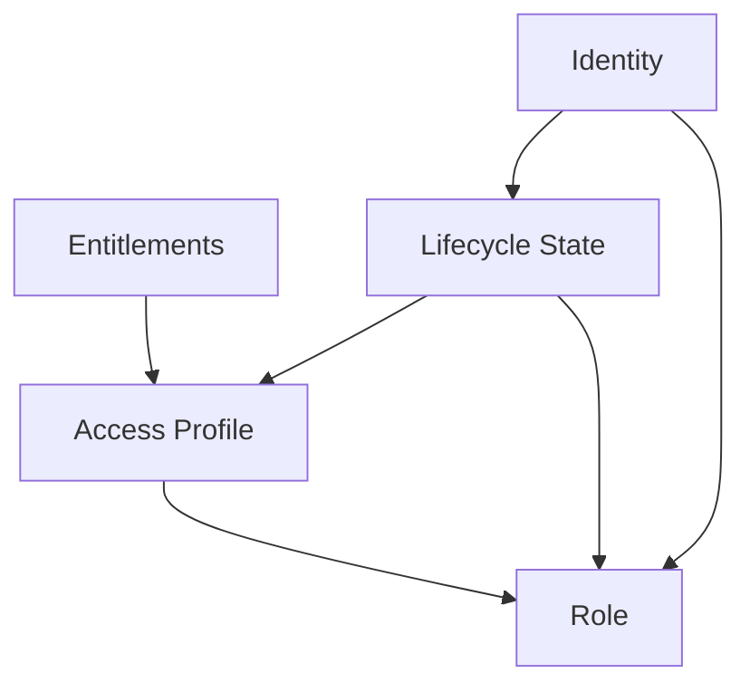
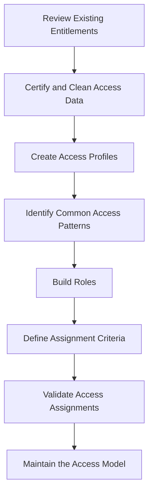
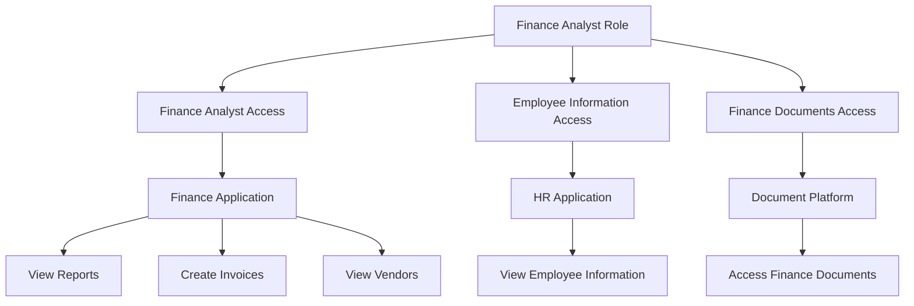

# 04. Modeling Access

## 1. Understanding the Access Model

In identity governance, knowing who a person is and which accounts belong to them is not enough. An organisation must also understand what access those people require to perform their responsibilities.

This is the purpose of an **Access Model**.

An Access Model is a structured way of organising access privileges so that they can be assigned, requested, provisioned, reviewed, and governed consistently.

Without a defined access model, organisations may end up managing individual permissions separately across hundreds of applications. This makes access administration difficult and increases the risk of excessive or inappropriate permissions.

Identity Security Cloud uses four building blocks to organise access:

1. Entitlements
2. Access Profiles
3. Roles
4. Lifecycle States

Together, these components help represent the access requirements of an organisation.

## 2. The Four Building Blocks

### 2.1 Entitlements

An **Entitlement** represents an access right that an account has within a source system.

It is one of the most fundamental units of access in ISC.

An entitlement determines what an account is allowed to do within an application or system.

Examples include:

- Membership in an application group.
- Permission to access a particular department.
- Access to financial reporting functions.
- Permission to create or approve transactions.
- Access to a specific application resource.

#### Example

Consider an employee who has an account in a Finance application.

The account may have the following entitlements:

| Entitlement | Access provided |
|---|---|
| Finance-Reports | View financial reports. |
| Invoice-Entry | Create invoice records. |
| Vendor-Management | Manage vendor information. |
| Payment-Approval | Approve payments. |

Each entitlement represents a particular access right within the source.

#### Why are entitlements important?

Entitlements provide the detailed information needed to understand and govern access.

They can be:

- Assigned directly to users.
- Grouped into Access Profiles.
- Included in Roles.
- Reviewed during access certifications.
- Made available for access requests, where configured.

**Key takeaway:** An entitlement is an individual access right associated with an account in a source system.

### 2.2 Access Profiles

An **Access Profile** is a collection of related entitlements from a single source.

Instead of assigning individual entitlements separately, an organisation can group related access rights into a single profile.

This makes access easier to manage and understand.

#### Example

An organisation has a Finance application containing several entitlements.

It creates an Access Profile called `Finance Analyst Access`.

| Included entitlement | Purpose |
|---|---|
| Finance-Reports | View financial reports. |
| Invoice-Entry | Create invoice records. |
| Vendor-View | View vendor information. |

These entitlements are grouped into one Access Profile.

When an employee needs this set of permissions, the organisation can manage the profile as a single access item.

#### Why are Access Profiles useful?

- Group related entitlements.
- Simplify access requests.
- Support automated provisioning.
- Make access easier to review during certifications.
- Provide a reusable set of access within a source.

An Access Profile can be used in Roles and Lifecycle States. It can also be configured to be requestable.

**Important:** An Access Profile groups entitlements from a single source. It does not itself represent an employee's entire job function across multiple applications.

**Key takeaway:** An Access Profile is a bundle of related entitlements from one source.

### 2.3 Roles

A **Role** groups related access according to an individual's job function, department, location, or other organisational attributes.

Unlike an Access Profile, which contains entitlements from a single source, a Role can bring together access from multiple sources.

Roles help organisations model access around business responsibilities rather than managing permissions application by application.

#### Example

Consider an employee working as a Finance Analyst.

The employee may require access to:

- A Finance application.
- An HR application for employee information.
- A document-sharing platform.
- A reporting application.

The organisation can create a `Finance Analyst` Role that combines the relevant Access Profiles from these different systems.

| Access Profile | Source |
|---|---|
| Finance Analyst Access | Finance Application |
| Employee Information Access | HR Application |
| Finance Documents Access | Document Platform |
| Reporting Access | Reporting Application |

All these Access Profiles can be grouped under one Role.

#### How Roles are assigned

Roles can support:

- Automated assignment based on configured identity attributes or other criteria.
- Access requests, where the role is configured as requestable.
- Automated provisioning of the access contained in the role.

For example, an organisation may configure a role assignment rule based on an employee's department and job title.

An employee who meets the configured criteria can automatically receive the corresponding Role.

#### Role types

ISC documentation describes two role types:

| Role type | Explanation |
|---|---|
| Standard Role | Groups access and assigns it based on configured assignment criteria or manual assignment. |
| Dynamic Role | Uses role dimensions to provide more granular access based on attributes such as location. |

A Dynamic Role can help avoid creating many separate roles that differ only by one attribute.

For example, a retail organisation might have one Store Clerk role with different access dimensions for each store location.

**Key takeaway:** A Role groups access around business responsibilities and can combine Access Profiles from multiple sources.

### 2.4 Lifecycle States

A **Lifecycle State** represents a person's current status or stage within an organisation and can determine what access they should receive.

Employees do not require the same access throughout their entire relationship with an organisation.

For example:

- A person preparing to join may need onboarding access.
- An active employee needs access required for their current responsibilities.
- An employee on leave may require restricted access.
- A terminated employee should no longer retain ordinary organisational access.

Lifecycle States help organisations manage these changes through configured access rules.

#### Example

Consider the lifecycle of an employee.

| Lifecycle stage | Possible access requirement |
|---|---|
| Pre-hire | Limited onboarding access. |
| Active | Access required for the employee's job. |
| Leave of absence | Access may be restricted according to policy. |
| Terminated | Access should be removed according to offboarding requirements. |
| Archived | Identity is retained for appropriate historical or governance purposes. |

These are examples of lifecycle stages. The actual lifecycle states and access rules depend on the organisation's configuration.

#### How Lifecycle States affect access

Lifecycle States can be configured to:

- Grant Access Profiles.
- Remove access.
- Enable or disable source accounts.
- Apply different access requirements when an identity changes status.

Lifecycle States are configured within an Identity Profile.

An identity is assigned one Lifecycle State at a time.

For example, when an employee moves into a terminated state, ISC can be configured to remove access and disable the relevant accounts.

**Key takeaway:** Lifecycle States connect a person's organisational status to the access they should have.

---

## 3. How the Access Model Components Relate

The four components have different responsibilities and should not be treated as interchangeable.

The first three form an access grouping structure:

- Entitlements are individual access rights.
- Access Profiles group related entitlements from one source.
- Roles group access across sources according to organisational responsibilities.

Lifecycle States work alongside these components by determining which access should be granted or removed based on an identity's status.

### Conceptual hierarchy

This is a conceptual relationship, not a strict containment hierarchy. In particular, Lifecycle States do not contain Roles in the same way that Roles group access items. They can determine access through configured Access Profiles and other lifecycle-related rules.

### Comparison of the four components

| Component | What it represents | Scope |
|---|---|---|
| Entitlement | An individual access right. | A source system. |
| Access Profile | A bundle of related entitlements. | One source system. |
| Role | A collection of access associated with a job function or other organisational criteria. | Can span multiple sources. |
| Lifecycle State | A person's organisational status and associated access requirements. | Identity lifecycle. |

## 4. Why Model Access?

A well-designed Access Model makes identity governance easier to manage.

Its benefits extend across access requests, certifications, provisioning, and compliance.

### 4.1 Simplifies Access Requests

Without an Access Model, users may need to understand and select individual technical permissions.

This can be confusing, especially when the permission names are designed for administrators rather than business users.

Access Profiles and Roles allow organisations to present meaningful groups of access.

For example, instead of requesting three separate Finance entitlements, an employee may request `Finance Analyst Access`.

This simplifies the selection and approval process.

### 4.2 Improves Access Certifications

During access certifications, reviewers need to understand what permissions employees currently have.

A well-structured Access Model makes this easier.

For example, a reviewer can understand that an employee has a `Finance Analyst` Role rather than examining numerous unrelated permissions individually.

The model also helps reviewers identify whether the access aligns with the employee's responsibilities.

### 4.3 Supports Automated Provisioning

Once access is organised into profiles and roles, the organisation can configure automated provisioning.

For example, when an employee joins the Finance department and meets the configured assignment criteria, ISC can assign the appropriate Role and provision its associated access.

When the employee changes departments, the organisation can configure the model to remove access that is no longer appropriate.

### 4.4 Supports Consistent Governance

An Access Model defines expected access patterns.

Governance processes can use these definitions to help determine whether users have appropriate access.

This supports:

- Consistent access assignment.
- Easier access reviews.
- More efficient provisioning.
- Identification of unnecessary access.
- Better visibility into access-related decisions.

---

## 5. Guidelines for Designing an Access Model

Creating an Access Model requires more than grouping permissions together. The structure should reflect actual business requirements while maintaining security.

### 5.1 Enforce the Principle of Least Privilege

The Principle of Least Privilege means granting users only the access necessary to perform their responsibilities.

Access Profiles and Roles should therefore avoid including unnecessary permissions.

#### Example

A Finance Analyst may need permission to create invoices and view financial reports.

They may not need permission to approve payments.

Including payment approval in the Finance Analyst Role would grant excessive access.

The model should separate responsibilities and provide only the required permissions.

### 5.2 Avoid Duplicate and Subset Access Profiles

One of the implementation mistakes highlighted in the course is creating overlapping Access Profiles without a clear reason.

Consider two profiles:

| Access Profile | Entitlements |
|---|---|
| Profile A | A, B, C |
| Profile B | A, B, C, D |

Profile B already includes every entitlement in Profile A, plus one additional entitlement.

If both profiles are assigned, the user receives overlapping access.

This can make it difficult to understand why a user has a particular entitlement and which profile is responsible for it.

#### Better approach

If A, B, and C form one valid standalone access set, while D is a separate permission, consider:

| Access Profile | Entitlements |
|---|---|
| Profile A | A, B, C |
| Profile D | D |

This avoids unnecessary duplication.

The objective is not to eliminate every overlap in an organisation's access. It is to avoid redundant or poorly designed groupings that make governance harder.

### 5.3 Use Business-Friendly Names and Descriptions

Access items often have technical names that are meaningful to application administrators but confusing to ordinary employees and business reviewers.

For example:

| Technical name | Business-friendly description |
|---|---|
| `FIN_AP_GRP_02` | Finance Invoice Processing |
| `HR_READ_L2` | Read-only HR Information |
| `DOC_SHARE_MGR` | Document Sharing Manager |

Roles, Access Profiles, applications, and entitlements should have clear names and descriptions.

This helps users and reviewers understand:

- What they are requesting.
- What access they are approving.
- What permissions they are provisioning.
- What access they are reviewing during certifications.

A good description should explain the actual business purpose of the access, not merely repeat its technical name.

---

## 6. Recommended Implementation Strategy

The course recommends beginning with entitlement certifications before moving towards Access Profiles and Roles.

The reason is simple: higher-level access groupings are only useful when the underlying access data is understood and reasonably clean.

### Step 1: Review Entitlements

Start by examining the individual entitlements available across connected applications.

Identify:

- What each entitlement allows a user to do.
- Which users currently have it.
- Whether it is still required.
- Whether it creates a security or compliance concern.

Certification helps review existing entitlement assignments and identify inappropriate access.

### Step 2: Build Access Profiles

Once the entitlement data has been reviewed, group related entitlements into Access Profiles.

For example, permissions that collectively support Finance invoice processing can be grouped into one profile.

### Step 3: Identify Role Patterns

After Access Profiles have been created, examine how access is distributed across different employee populations.

Look for recurring combinations of access associated with:

- Job titles.
- Departments.
- Locations.
- Business responsibilities.

These patterns can help determine which Access Profiles belong together in a Role.

### Step 4: Create and Configure Roles

Create Roles that reflect genuine business responsibilities.

Define:

- The Role's purpose.
- Its included Access Profiles and entitlements.
- Its ownership.
- The criteria for assigning it.
- Whether it should be available for access requests.

### Step 5: Validate the Model

Review the resulting access assignments.

Check whether:

- Users receive the expected access.
- Unnecessary entitlements are excluded.
- Overlapping profiles are handled appropriately.
- Role assignment criteria reflect actual job responsibilities.
- Access can be provisioned and removed as intended.

### Implementation flow

**Why this order matters:** Roles built on inaccurate or poorly understood entitlement data can reproduce existing access problems at a larger scale.

---

## 7. Maintaining the Access Model

An Access Model is not a one-time configuration.

Organisations change continuously:

- Employees change departments.
- Job responsibilities evolve.
- New positions are introduced.
- Applications are added or retired.
- Existing permissions change.
- New business requirements emerge.

If the Access Model is not maintained, it can become outdated and may no longer reflect the organisation's actual access requirements.

### Role and Access Ownership

Organisations should assign owners who are responsible for keeping access definitions current.

Owners may be responsible for:

- Reviewing the access included in Roles.
- Confirming whether Access Profiles remain appropriate.
- Coordinating changes with business teams.
- Reviewing new access requirements.
- Identifying unnecessary or outdated permissions.

For example, the Finance department may have a designated business owner responsible for validating whether the `Finance Analyst` Role still contains the correct access.

Ownership makes the Access Model a governed business resource rather than an unmanaged collection of permissions.

### AI Recommendations

Identity Security Cloud incorporates AI capabilities that can assist organisations in developing and maintaining their Access Models.

AI-driven recommendations can help identify patterns in existing access and support decisions about how roles should be structured.

For example, if employees with similar job responsibilities repeatedly hold similar combinations of access, these patterns may help identify potential role groupings.

However, recommendations should be evaluated against actual business responsibilities and security requirements.

**Important:** AI recommendations support access modelling. They should not replace business ownership, access reviews, or security decisions.

---

## 8. Practical Example: Building an Access Model for Finance

Consider an organisation with a Finance department.

Employees have accounts in three applications:

1. Finance Application.
2. HR Application.
3. Document Management Platform.

The organisation wants to model access for Finance Analysts.

### Step 1: Identify entitlements

| Source | Entitlement |
|---|---|
| Finance Application | View Reports |
| Finance Application | Create Invoices |
| Finance Application | View Vendors |
| HR Application | View Employee Information |
| Document Platform | Access Finance Documents |

### Step 2: Create Access Profiles

| Access Profile | Source | Included entitlements |
|---|---|---|
| Finance Analyst Access | Finance Application | View Reports, Create Invoices, View Vendors |
| Employee Information Access | HR Application | View Employee Information |
| Finance Documents Access | Document Platform | Access Finance Documents |

### Step 3: Create a Role

Create a `Finance Analyst` Role containing all three Access Profiles.

### Step 4: Define assignment criteria

The organisation may configure the Role to be assigned to identities whose department and job title meet the required criteria.

### Step 5: Connect it to lifecycle requirements

The organisation can configure lifecycle-related access so that employees receive appropriate access when they become active and lose access when they leave the organisation.

The result is a reusable and understandable access structure.

This example illustrates the relationship between the building blocks. The actual entitlements and assignment rules would need to be validated against the organisation's policies.

---

## 9. Quick Reference

| Term | Definition |
|---|---|
| Access Model | A structured representation of how organisational access is organised and governed. |
| Entitlement | An individual access right associated with an account on a source. |
| Access Profile | A bundle of related entitlements from a single source. |
| Role | A collection of access associated with a job function or other organisational criteria, potentially spanning multiple sources. |
| Lifecycle State | Represents an identity's organisational status and can drive access changes. |
| Least Privilege | Granting only the access required for assigned responsibilities. |
| Access Ownership | Assigning responsibility for reviewing and maintaining access definitions. |
| AI Recommendations | AI-supported suggestions that can help identify and maintain access patterns and role structures. |

## 10. Key Takeaways

- The Access Model organises permissions so they can be governed consistently.
- Entitlements are the individual access rights within source systems.
- Access Profiles group related entitlements from a single source.
- Roles group access according to business responsibilities and can span multiple sources.
- Lifecycle States determine access requirements based on a person's organisational status.
- A good Access Model simplifies requests, certifications, and provisioning.
- Least privilege should guide the design of every Access Profile and Role.
- Duplicate and subset Access Profiles can create unnecessary complexity.
- Reviewing entitlement data before building higher-level access groupings improves the quality of the model.
- Access Models require ownership and ongoing maintenance.
- AI recommendations can support role development, but business validation remains essential.

---

*These notes are independently prepared learning material based on SailPoint University course content and supplementary conceptual explanations. For current product behaviour and configuration details, refer to SailPoint's official documentation.*
