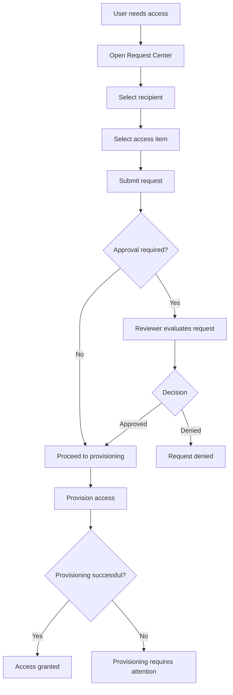
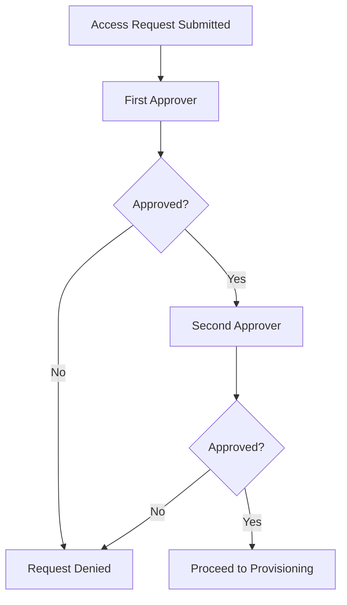

# 05. Access Requests

## 1. Understanding Access Requests

An **Access Request** is an interactive process through which a user requests a specific access item, such as a Role, Access Profile, or Entitlement.

Organisations use access requests to ensure that users can obtain the permissions required for their responsibilities through a controlled and traceable process.

Instead of contacting an administrator to manually assign permissions, users can request available access through the **Request Center** in Identity Security Cloud.

The request then follows the approval and provisioning processes configured by the organisation.

### Why are Access Requests important?

Access Requests help organisations:

- Give employees a structured way to request the access they need.
- Ensure access is reviewed before it is granted when approval is required.
- Apply consistent approval procedures.
- Automate access provisioning after approval.
- Maintain visibility into requested, approved, denied, and provisioned access.

**Important distinction:** Requesting access does not automatically grant access. The request must complete the applicable review and provisioning steps.

---

## 2. What Can Users Request?

The Access Model provides the building blocks that users can request.

Depending on the organisation's configuration, users may request:

| Requestable item | What the user receives |
|---|---|
| Entitlement | An individual access right within a source system. |
| Access Profile | A bundle of related entitlements from one source. |
| Role | A collection of access associated with a business responsibility. |
| Application | A way to browse access profiles associated with a particular application. |

For example, an employee working in Finance may request the `Finance Analyst` Role instead of requesting several individual permissions.

An organisation must configure access items to make them available for requests. Not every entitlement, Access Profile, or Role is automatically requestable.

---

## 3. Request Center

The **Request Center** is the interface in Identity Security Cloud through which users can request access.

Users can submit requests for themselves and, when enabled by the organisation, for other people.

The Request Center provides a central place to:

- Browse available access.
- Select Roles, Access Profiles, or Entitlements.
- Submit access requests.
- Provide required information and comments.
- Track request progress.

### 3.1 Requesting Access for Different People

ISC provides three request scenarios described in the course.

| Request option | Who can submit the request? | Who receives the access? |
|---|---|---|
| Request for myself | The user. | The requester. |
| Request for direct reports | Managers. | Their direct reports. |
| Request for anyone | Any authorised user under the organisation's configuration. | The selected person. |

The organisation decides which of these options should be enabled.

#### Option 1: Users request access for themselves

Employees can request the access they need to perform their jobs.

**Example:** Priya needs access to the Finance reporting application. She opens the Request Center, selects the required access, and submits a request.

#### Option 2: Managers request access for their direct reports

Managers can request access on behalf of employees who report directly to them.

**Example:** A manager is onboarding a new Finance Analyst and requests the necessary application access for that employee.

#### Option 3: Any user can request access for another user

An organisation can allow users to request access for any other person in the organisation.

**Example:** An authorised team member submits an access request for a colleague working on a shared project.

**Key point:** Requesting access for another person is a configurable capability. It is not automatically available to every user.

---

## 4. How Access Requests Work

An access request generally follows these stages:

1. The requester selects the person who needs access.
2. The requester selects the required Role, Access Profile, or Entitlement.
3. The request is submitted.
4. The configured approval process is initiated, if approval is required.
5. The request is approved or denied.
6. Approved access moves to provisioning.
7. ISC attempts to apply the access change to the relevant source system.
8. The request status can be tracked.

### Access Request Workflow

The important distinction is that approval and provisioning are separate stages.

A request can be approved but still encounter a problem while the access is being applied to the source system.

---

## 5. Approving Access Requests

An organisation can configure approval requirements for individual access items.

For example, an Access Profile can be configured to require approval before it is granted.

The configuration determines:

- Whether approval is required.
- Which users or groups are responsible for reviewing the request.
- Whether multiple approval stages are necessary.
- The order in which approvals must occur.

### 5.1 Single Approval

A request may require approval from one designated reviewer.

For example, a manager may need to approve an employee's request for access to a departmental application.

Once the required approval is received, the request can proceed to provisioning.

### 5.2 Multiple Approvals

Some access requests may require approval from more than one person.

For example, access to a sensitive Finance application may require approval from both the employee's manager and the application owner.

The approvals follow the configured sequence.

As explained in the course:

- The first approver receives the approval notification.
- The next approver is notified only after the previous approver approves.
- If any required approver denies the request, the remaining approval process stops.
- Access is not provisioned following a denial.

### 5.3 Approval Notifications

When an approval is required, the assigned approver receives an email notification.

The notification informs the approver that an access request requires review.

Approvers can then examine the request and make a decision.

Depending on the tenant configuration, approval information and tasks can also be accessed through the platform's approval interface.

### 5.4 Approval Is Not Always Mandatory

An important detail: not every access request must go through an approval process.

Approval requirements are determined by the organisation's configuration for the relevant access item.

A request that does not require approval can proceed directly to provisioning, subject to other configured conditions.

**Key point:** The approval process is configurable. Do not assume that every request always requires at least one approval.

---

## 6. Provisioning After Approval

Once the required approvals are completed, the request proceeds to provisioning.

**Provisioning** is the process of applying the requested access change to the relevant source system.

For example, if Priya's request for the Finance Analyst Access Profile is approved, ISC attempts to provision the entitlements included in that profile to the appropriate account.

The access change takes place on the connected application or source system, not merely within the Request Center.

### What happens during provisioning?

1. ISC processes the approved request.
2. The requested access is translated into the relevant provisioning operations.
3. ISC communicates with the source system through the configured integration.
4. The source system applies the requested access change.
5. The provisioning result is reflected in the request's status and related activity.

### Example

Priya requests access to a Finance application.

The request contains the `Finance Analyst Access` profile, which includes:

- View financial reports.
- Create invoices.
- View vendor information.

After the required approval, ISC attempts to provision these entitlements to Priya's relevant Finance application account.

If the provisioning operation succeeds, the requested access becomes available through that application.

### Existing and New Accounts

The course explains that approved access can be applied to:

- Accounts the user already owns.
- New accounts the user will own once the request is granted.

This is important because an employee may need access to an application in which they do not yet have an account.

The provisioning process may therefore involve creating an account as well as assigning the requested access, depending on the source configuration.

**Key point:** Approval authorises the request. Provisioning carries out the actual access change.

---

## 7. Tracking Access Requests

An access request should be traceable throughout its lifecycle.

Users and administrators need to know whether a request is:

- Submitted.
- Waiting for approval.
- Approved.
- Denied.
- Being provisioned.
- Successfully provisioned.
- Experiencing a provisioning issue.

Tracking provides visibility into the progress of an access request and helps identify where action may be required.

For example, if an employee has received approval but still cannot access an application, the administrator can investigate whether provisioning completed successfully.

---

## 8. Important Access Request Concepts

### 8.1 Requestability

An access item must be configured to allow access requests before it becomes available for users to request.

This applies to Roles and Access Profiles, and request availability for entitlements is also controlled through configuration.

### 8.2 Request Forms

Organisations can require users to complete an access request form.

Forms can collect additional information needed to evaluate the request.

For example, a request for temporary project access may require the requester to provide a business justification and an end date.

### 8.3 Access Duration

Some access requests may have a defined start date and end date.

This is useful when access is needed only temporarily, such as for a project or a short-term assignment.

The organisation can configure whether an end date is required for particular requestable items.

### 8.4 Multiple Accounts

An identity may have multiple accounts on the same source.

When the requester is asked to select an account, they must identify which account should receive the requested access.

This prevents access from being assigned to an unintended account.

### 8.5 Request Approval vs. Access Certification

These two processes are related but serve different purposes.

| Access Requests | Access Certifications |
|---|---|
| Used to request new access or changes to access. | Used to review existing access. |
| Usually initiated by a user or someone acting on their behalf. | Initiated through a certification campaign. |
| Follows the configured request approval process. | Follows the assigned certification review process. |
| Can result in new access being provisioned. | Can result in existing access being retained or revoked. |

**Remember:** An Access Request asks for access. An Access Certification checks whether existing access should continue.

---

## 9. Practical Example: Requesting Finance Application Access

Consider a new employee, Priya, who joins the Finance department.

Her manager determines that she needs access to the Finance application.

### Step 1: Submit the request

The manager opens the Request Center and selects Priya as the recipient.

### Step 2: Select the access item

The manager selects the `Finance Analyst Access` profile.

### Step 3: Submit the request

The request is submitted with any required information, such as a business justification.

### Step 4: Approval

The request is routed to the configured approver.

If multiple approvals are required, they take place in the configured order.

### Step 5: Provisioning

Once all required approvals are completed, ISC initiates provisioning.

The requested entitlements are applied to Priya's appropriate account.

### Step 6: Completion

The request status reflects the result of provisioning.

Priya can use the Finance application once the access has been successfully granted.

---

## 10. Quick Reference

| Term | Meaning |
|---|---|
| Access Request | A process for requesting a Role, Access Profile, or Entitlement. |
| Request Center | The ISC interface for submitting access requests. |
| Requester | The person who submits the access request. |
| Recipient | The person who will receive the requested access. |
| Approver | The person or designated reviewer responsible for reviewing a request. |
| Approval Process | The configured sequence of reviews required before access can be granted. |
| Provisioning | Applying the requested access change to the relevant source system. |
| Requestability | Configuration that determines whether an access item can be requested. |
| Request Form | A form used to collect additional information during a request. |

## 11. Knowledge Check

**Question:** Before Identity Security Cloud can provision new access, must all access requests be approved by at least one identity?

**Correct answer: False.**

Approval is not mandatory for every access request. The organisation configures whether a particular access item requires approval.

If approval is not required, the request can proceed directly to provisioning, subject to the applicable configuration and processing conditions.

## 12. Key Takeaways

- Access Requests allow users to request the access they need through ISC.
- Requestable items can include Roles, Access Profiles, and Entitlements.
- The Request Center provides a central interface for requesting access.
- Organisations can allow users to request access for themselves, their direct reports, or other users.
- Approval requirements are configured for the relevant access items.
- Multiple approvers can be required, with approvals occurring in a defined sequence.
- A denial stops the remaining approval process and prevents the requested access from being granted.
- Approved access moves to provisioning.
- Provisioning applies the access change to the relevant source system.
- A request can be approved but still experience a provisioning failure.
- Access Requests and Access Certifications are different governance processes.

---

*These notes are independently prepared learning material based on SailPoint University course content and supplementary conceptual explanations. Product configuration and available options may vary by tenant and licensing.*
