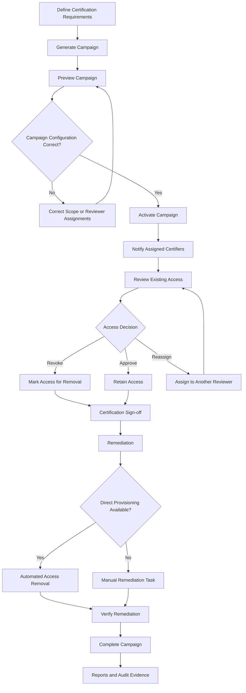

# 06. Access Certification

## 1. What Is Access Certification?

**Access Certification** is an identity governance process in which a designated authority reviews the access assigned to users and determines whether that access is still appropriate.

The reviewer may be a user's manager, a source owner, an access owner, or another authorised person, depending on how the certification campaign is configured.

During a review, the certifier can:

- **Approve:** Confirm that the existing access is appropriate and should be retained.
- **Revoke:** Decide that the access is no longer required and should be removed.
- **Reassign:** Transfer the review responsibility to another appropriate reviewer, where permitted.

The purpose is to ensure that users retain only the access they need to perform their responsibilities.

### Access Request vs. Access Certification

These two processes are related, but they serve different purposes.

| Access Request | Access Certification |
|---|---|
| A user requests access. | An authorised reviewer examines existing access. |
| Focuses on obtaining new access. | Focuses on validating access already assigned. |
| May require approval before provisioning. | May result in retaining or revoking existing access. |
| Usually initiated by a user or someone requesting on their behalf. | Initiated through a certification campaign. |

**Example:**

Priya joins the Finance department and requests access to a Finance application. This is an Access Request.

Six months later, her manager reviews whether she still needs that Finance application access. This is Access Certification.

**Remember:** Access Requests govern how access is obtained. Access Certifications govern whether existing access should continue.

---

## 2. Understanding a Certification Campaign

A **Certification Campaign** is a structured round of access reviews conducted within an organisation.

Instead of reviewing every user's access individually without coordination, an organisation can create a campaign that collects relevant access information and assigns reviews to designated certifiers.

Each assigned review is called a **Certification**.

For example, an organisation may conduct a quarterly access certification campaign for its Finance department.

The campaign may contain:

- Employees whose access must be reviewed.
- Their existing accounts and access privileges.
- The reviewers responsible for each review.
- The deadline for completing the reviews.
- The decisions made by reviewers.
- The remediation actions resulting from revoked access.

### Why do organisations conduct certification campaigns?

**1. Security and risk reduction**

Identifies excessive, inappropriate, outdated, or unnecessary access.

**2. Regulatory and audit compliance**

Helps organisations demonstrate that access to sensitive systems and information is reviewed regularly.

**3. Accountability**

Establishes who reviewed access, what decisions were made, and when those decisions were recorded.

**4. Visibility**

Provides a clearer understanding of who has access to which applications, systems, and resources.

**5. Access governance**

Helps ensure that access remains aligned with users' current job responsibilities.

---

## 3. Important Participants in Access Certification

Different people may be involved in a certification campaign.

| Participant | Responsibility |
|---|---|
| Campaign Administrator | Configures, generates, monitors, and manages certification campaigns. |
| Certifier / Reviewer | Examines assigned access and makes certification decisions. |
| Manager | Reviews the access of employees reporting to them. |
| Source Owner | Reviews access associated with a particular source or application. |
| Access Owner | Reviews access items for which they are responsible. |
| Role Owner | Reviews the composition of a role. |
| Identity | The person whose access is being reviewed. |

The exact reviewer depends on the campaign type and configuration.

### Who can be a certifier?

Common reviewer options include:

- Manager
- Source Owner
- Access Owner
- Role Owner
- Individual reviewer
- Governance Group
- Account Owner

For example, a manager may be responsible for reviewing the access of their direct reports, while a source owner may review access associated with a particular application.

**Important distinction:** The person whose access is being reviewed is not necessarily the person making the certification decision.

---

## 4. The Certification Process

The certification process is not simply a reviewer clicking Approve or Revoke. It follows a structured lifecycle.

The main stages are:

1. Campaign Generation
2. Campaign Preview
3. Campaign Activation
4. Active Review
5. Certification Sign-off
6. Access Remediation
7. Campaign Completion

### Stage 1: Campaign Generation

The process begins when an administrator defines what needs to be reviewed.

The administrator configures the campaign requirements, including:

- Campaign name and description.
- Identities or access items to be reviewed.
- Applications or sources included.
- Reviewer selection.
- Campaign filters or search criteria.
- Due date.
- Notification settings.
- Treatment of undecided access items.

The campaign can be configured to review particular identities, access items, or roles, depending on the campaign type.

For example, an organisation may create a campaign to review all access assigned to employees in the Finance department.

ISC uses the configured criteria to determine which identities and access items should be included.

**Purpose:** Define the scope of the access review.

### Stage 2: Campaign Preview

After the campaign is generated, ISC creates a preview of the proposed certification campaign.

The preview allows the administrator to examine the campaign before sending it to reviewers.

The administrator can check:

- Which identities are included.
- Which access items will be reviewed.
- Who the assigned reviewers are.
- How many identities each reviewer must certify.
- Whether the campaign scope is correct.
- Whether any reassignment is necessary.

This is an important validation step.

For example, if the Finance manager is incorrectly assigned as the reviewer for another department's employees, the administrator can identify and correct the assignment before activation.

**Purpose:** Validate the campaign contents and reviewer assignments before the actual review begins.

### Stage 3: Campaign Activation

Once the preview has been reviewed and the configuration is considered correct, the administrator starts the campaign.

This moves the campaign into its active review stage.

The assigned certifiers are notified when notifications are enabled.

They can then access their assigned certifications and begin reviewing the access items.

**Purpose:** Make the campaign available to reviewers and begin the certification exercise.

### Stage 4: Active Review

This is the stage in which certifiers examine the assigned access and make decisions.

The certifier reviews the access information and determines whether it is appropriate for the identity.

For each review item, the available decisions may include:

| Decision | Meaning |
|---|---|
| Approve | Retain the existing access. |
| Revoke | Remove the existing access. |
| Acknowledge | Acknowledge access that is controlled by another mechanism, where applicable. |

The exact decisions available depend on the access item and how it was assigned.

#### Example

Priya works in the Finance department and has the following access:

| Access item | Manager's decision | Reason |
|---|---|---|
| Finance Reports | Approve | Required for her job. |
| Invoice Processing | Approve | Part of her responsibilities. |
| Payment Approval | Revoke | No longer required. |

The manager approves the first two access items and revokes the third.

#### Reassignment during review

Sometimes the assigned certifier may not be the right person to make a decision.

For example:

- The manager is on leave.
- The reviewer does not understand the business purpose of the access.
- Another person has better knowledge of the application.
- A different owner should be responsible for the review.

In such situations, certification reassignment may be used to transfer the review to another appropriate person.

The system also has safeguards to prevent a person from reviewing their own access.

**Purpose:** Determine whether each assigned access item should be retained or revoked.

### Stage 5: Certification Sign-off

Making individual decisions and completing the certification are not necessarily the same action.

After reviewing the assigned items, the certifier must submit or sign off on the certification.

Sign-off confirms that the reviewer has completed their assigned review and submitted their decisions.

This step is important because decisions that have not been signed off may not be applied as expected.

For example, a reviewer may mark an entitlement for revocation but leave the certification unfinished. The revocation should not be assumed to have been completed merely because the decision was selected.

**Purpose:** Formally submit the review decisions.

### Stage 6: Access Remediation

Once the certification decisions are signed off, ISC initiates remediation for access marked for revocation.

**Remediation** is the process of carrying out the corrective action resulting from a governance decision.

There are two important remediation methods.

#### A. Automated Remediation

If ISC has a direct connection to the source system and the required provisioning capability, it can automatically remove the revoked access.

Example:

A manager revokes Priya's Finance application entitlement.

If the source supports the required provisioning operation, ISC can automatically send the change to the Finance application and remove that entitlement.

#### B. Manual Remediation

Sometimes ISC cannot directly make the required change in the source system.

In such cases, a task may be created for the source owner or another responsible person to perform the change manually.

Example:

A manager revokes access to an application that does not support direct provisioning through ISC.

ISC creates a remediation task instructing the responsible owner to remove that access in the application.

The organisation can then track and verify that the required change has been completed.

**Important:** A Revoke decision is not the same as successful access removal. Remediation must be completed and verified.

### Stage 7: Campaign Completion

After the review decisions and required administrative actions have been addressed, the administrator completes the campaign.

Campaign completion allows the organisation to close the review exercise and examine its results.

Administrators can review reports to understand:

- Which access items were approved.
- Which access items were revoked.
- Who made the decisions.
- Whether remediation was completed.
- Which items remain unresolved.
- Whether any reviewers failed to complete their assigned certifications.

The campaign also provides an audit trail of the certification activity.

**Purpose:** Close the campaign and retain evidence of the review and its outcomes.

---

## 5. Certification Lifecycle Diagram

The diagram illustrates the general workflow. Actual campaign settings determine how undecided items, reassignment, and remediation are handled.

---

## 6. Certification Deadlines and Reminders

Certification campaigns normally have a deadline by which reviewers are expected to complete their assigned reviews.

Administrators can monitor campaign progress and remind reviewers to finish outstanding certifications.

SailPoint's current documentation describes configurable reminder emails, including notifications when a campaign is activated and recurring reminders while reviews remain incomplete.

If reviewers do not finish their certifications, administrators may need to address the outstanding decisions before completing the campaign.

### What happens to undecided access?

An important campaign configuration determines how access items without a final decision are handled.

Depending on the campaign configuration, undecided items may be maintained or handled through an administrator's completion decision.

This is important because automatically revoking undecided access can disrupt business operations.

**Best practice:** Organisations should carefully define how undecided access is handled rather than assuming that an unfinished review means access should be revoked.

---

## 7. What Access Can Be Certified?

Certifications can include different types of access items, depending on the campaign configuration and how access was assigned.

Common examples include:

- Entitlements.
- Access Profiles.
- Roles.

However, not every item appears as a separate certification item in every situation.

For example:

- Roles assigned through access requests can be approved or revoked.
- Roles assigned automatically through membership criteria may only be acknowledged because the role assignment is controlled by those criteria.
- Access Profiles granted through Roles or Lifecycle States are not necessarily presented as separate certification items.

This distinction matters because the access model determines how access is represented and governed.

---

## 8. Why Access Certification Matters for Audits

Access certification provides evidence that an organisation periodically reviews access to its systems.

For example, an auditor may ask:

- Who has access to the Finance application?
- Who reviewed that access?
- When was the review completed?
- Which access items were revoked?
- Was the revoked access actually removed?
- Is there evidence of the decisions?

Certification reports help organisations answer these questions.

### Important certification reports

| Report | Purpose |
|---|---|
| Campaign Composition Report | Shows how the campaign was configured, including its scope, reviewers, and deadline. |
| Campaign Status Report | Shows access items, reviewer decisions, and the status of certification items. |
| Campaign Remediation Status Report | Shows whether revoked access has been removed or whether remediation remains outstanding. |
| Certification Sign-off Report | Records certification sign-off information, including the reviewer and sign-off date. |

These reports help provide accountability and evidence for governance and audit activities.

---

## 9. Practical Example: Quarterly Finance Access Review

Consider an organisation that conducts quarterly access certifications for its Finance department.

### Situation

The organisation has 50 Finance employees with access to:

- Finance application.
- HR application.
- Document management platform.

The organisation wants to confirm that every employee still has the appropriate access.

### Process

1. The Certification Administrator creates a quarterly campaign for Finance employees.
2. ISC generates the campaign using the selected identities and access items.
3. The administrator previews the campaign and verifies the reviewer assignments.
4. The administrator activates the campaign.
5. Finance managers receive notifications to review their employees' access.
6. Managers examine each employee's access and approve or revoke individual items.
7. Reviewers sign off on their certifications.
8. ISC initiates automated remediation where direct provisioning is available.
9. Where direct provisioning is unavailable, manual remediation tasks are assigned.
10. The administrator verifies remediation and completes the campaign.
11. Reports are retained as evidence of the review.

### Outcome

The organisation has:

- A record of who reviewed access.
- Evidence of which permissions were approved or revoked.
- Visibility into outstanding remediation.
- Better control over inappropriate access.
- Documentation to support audit requirements.

---

## 10. Important Terms to Remember

| Term | Meaning |
|---|---|
| Access Certification | A review of existing user access to determine whether it remains appropriate. |
| Certification Campaign | A coordinated set of access reviews. |
| Certification | An individual review assigned to a certifier. |
| Certifier | The person responsible for reviewing assigned access. |
| Campaign Generation | Defining the campaign scope and creating its review contents. |
| Preview | Reviewing the proposed campaign and its reviewer assignments before activation. |
| Active Campaign | A campaign that has been started and is available for review. |
| Sign-off | Formal submission of the certifier's decisions. |
| Reassignment | Transferring a certification review to another appropriate reviewer. |
| Remediation | Carrying out the corrective action resulting from a certification decision. |
| Automated Remediation | Removing revoked access through a direct source connection. |
| Manual Remediation | Assigning a task to a responsible person to remove access outside ISC. |
| Campaign Completion | Closing the campaign after the required review and administrative actions. |

---

## 11. Key Takeaways

- Access Certification verifies whether existing access is still appropriate.
- A Certification Campaign is a structured round of access reviews.
- Managers, source owners, access owners, and other authorised reviewers may act as certifiers.
- Campaigns move through generation, preview, activation, review, sign-off, remediation, and completion.
- The Active phase is where certifiers make their review decisions.
- Reviewers can approve, revoke, or acknowledge access, depending on the item.
- Reassignment allows a review to be transferred to another appropriate reviewer.
- Sign-off is important because decisions should not be assumed to be final until submitted.
- Revoked access requires remediation.
- Remediation can be automated or manual.
- Campaign reports provide evidence for governance and audits.
- Access certification is an ongoing governance activity, not a one-time exercise.

---

## 12. Knowledge Check

**Q1. Certifiers make decisions on items in their access reviews during which phase?**

- Generation
- Preview
- Active

**Answer: Active**

The Active phase is when assigned reviewers examine access and make certification decisions.

**Q2. Only users with the Admin authorisation level can reassign access items to new certifiers.**

**Answer: False**

Certification reassignment is not conceptually restricted to the campaign administrator alone. Reviewers may have reassignment capabilities in supported workflows, while campaign administrators can also manage reviewer assignments. The exact available actions depend on the certification experience and permissions enabled in the tenant.

**Q3. What happens when a certifier revokes access?**

**Answer:** ISC initiates remediation after the certification decision is submitted and signed off. Access may be removed automatically through a direct source connection or through a manual task.

**Q4. Does a Revoke decision automatically prove that access has been removed?**

**Answer: No.** The remediation must be carried out and its completion verified.

---

*These notes are independently prepared learning material based on SailPoint University course content and supplementary explanations. Product behaviour and available certification features can vary by release and tenant configuration.*
